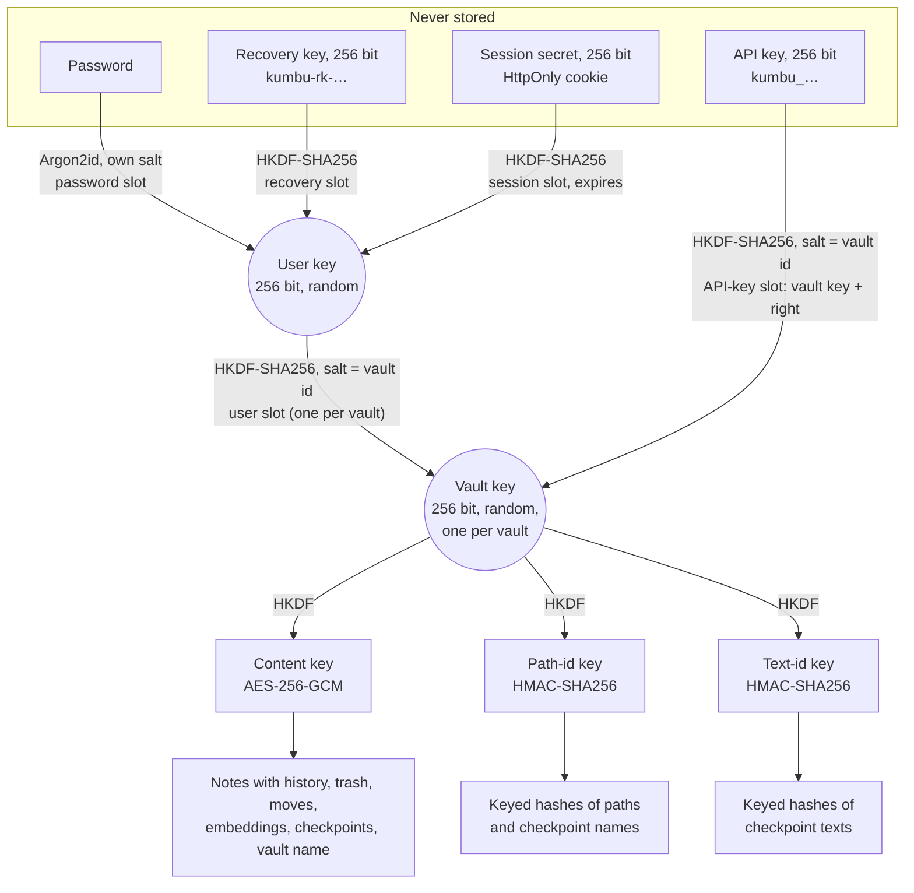

# Kumbu² — Security Architecture and Encryption at Rest

**Audience:** a technical decision-maker who decides whether employees' personal notes may live in Kumbu².
**Scope:** the code as built (accounts, API keys, web app, MCP endpoint; steps 1 to 9a). Everything that is only planned is in §9, "What comes next", and nowhere else.
**How to check it:** every key claim names the file (and, where useful, the line) in `src/` that implements it. The project is open source (AGPL-3.0-or-later). No external security audit has been done; the reviews so far were part of development.

## 1. Summary for a decision-maker

Kumbu² is a self-hosted Markdown notes server. People use it through a web app; AI agents (Claude Code and other MCP clients) use it through an API key that the person creates for chosen vaults. Notes are personal: there is no sharing between users.

**What it protects well.** Everything in the database is encrypted: note text, its history, the trash, folder and file names, vault names, the search vectors and checkpoints. Each vault has its own random key, and that key is stored only *wrapped* by the credentials of its owner (password, recovery key, a web session, an API key). A database dump, a stolen backup or the disk of a compromised hoster shows no readable content and no paths, only metadata such as user names, sizes and times. Admins manage accounts but cannot read notes, cannot see vault or note names, and cannot reset passwords.

**What it does not protect against.** It is *encryption at rest*, not end-to-end encryption. To search, render and edit, the server decrypts a vault into memory while it is in use (and for up to 15 idle minutes afterwards). Whoever controls the running server — the operator — can therefore read what is in use, and could change the server to capture passwords. The AI provider of a connected agent sees whatever that agent reads. These limits are by design and stated, not hidden.

**What that means for COR.energy.**

1. The decisive question is **who operates the instance**. For employees' personal notes, the operator must be someone COR trusts with that content: COR's own platform team on COR's own infrastructure (the planned `kumbu.internal.cor.energy`), not a third party. On Chris's community instance `kumbu.tidesson.net`, Chris is the operator.
2. **Admins are not the threat** the design worries about: the admin role grants no access to content (§4).
3. **No password reset, by design.** A user who loses both password and recovery key loses their notes. This has to be accepted and communicated.
4. **AI use follows COR's AI policy.** What an agent reads goes to its model provider. Kumbu² limits *which* vaults an agent can reach (and whether it may write), not what the provider does with what it receives.

## 2. Threat model and honest limits

### What is protected, against whom

| Threat | Protected? | Why |
|---|---|---|
| Database dump, stolen backup, hoster's disk | Yes, content and names | All content and paths sealed with AES-256-GCM under per-vault keys; keys stored only wrapped (§5). |
| Another user of the same instance | Yes | A user's vaults open only with their user key; other users' vaults are invisible, not merely refused (§4). |
| An admin (in the app) | Yes, content | The admin role carries no key material; admin screens show metadata only (`src/Kumbu.Server/Accounts/Admin.cs`). |
| A stolen API key | Limited to its vaults and rights | Slots per vault, right sealed into the slot; revocation deletes the slots at once (§6). |
| Cross-site attacks in the browser | Yes, as far as tested | `SameSite=Strict` cookie, `Origin` check, CSP, no raw HTML in rendered Markdown (§7). |
| Online password guessing | Rate-limited | Per username and per address (§7). |
| Offline password guessing from a dump | Slowed, not prevented | Argon2id with 64 MiB per guess (§5); a weak password remains guessable. |

### What is not protected

- **The operator of the running server.** While a vault is unlocked, its notes, paths, search vectors and the vault key itself are in the server's memory in plain form (`src/Kumbu.Server/Vaults/UnlockedVault.cs`, `VaultCatalog.cs:415`). The operator can read process memory, and can deploy a modified server or web app that records passwords, session cookies and API keys as they arrive (passwords are sent to the server and derived there; nothing is derived in the browser). Users who do not trust the operator must run their own instance.
- **The AI provider** of a connected client sees what the agent reads and writes. This is not end-to-end encryption and is never described as such (`README.md`, "Security").
- **Rollback by someone with write access to the database.** An older genuine version of a document (from a backup) can be put back; it opens, because it is genuine. Detecting this needs a per-vault counter or manifest; not built (`docs/superpowers/specs/2026-10-23-encryption-design.md` §5).
- **Metadata.** The database holds, in the clear: usernames and roles, sign-in times, which vaults belong to which user, how many documents a vault has and their sizes, revision numbers and times (details in §5.6). An admin sees some of this by design.
- **Keys in memory are not zeroed.** Locking a vault drops the reference; the bytes stay until the .NET garbage collector reuses them (`VaultCatalog.cs:361`). Swap and core dumps of the server can hold plaintext; the operator should disable both on the host.

### How long plaintext lives in memory

A vault is decrypted **completely** the first time a request uses it (notes, history, trash, moves, embeddings, checkpoint index; `VaultCatalog.cs:415–466`) and served from memory afterwards. A sweep once a minute (`src/Kumbu.Server/Vaults/VaultSweeper.cs:9`) locks a vault after **15 idle minutes** (`Kumbu:Vaults:IdleMinutes`, `src/Kumbu.Server/KumbuOptions.cs:79`), and the least recently used vaults when all unlocked vaults together exceed a memory cap (default 512 MB, `KumbuOptions.cs:82`). A vault used in the last minute is never locked. A restart locks everything; but because sessions and API keys live in the database (§6), the next request with a valid cookie or key unlocks the vault again without the user doing anything.

The unlocked cache never replaces authorisation: every request derives its own lookups and unwraps its own slot, and a cached vault is handed out only if the unwrapped key matches it (`VaultCatalog.cs:420–423`).

## 3. Keys and slots

### The hierarchy

Every user has a random 256-bit **user key**. Every vault has a random 256-bit **vault key**. Neither is ever stored in the clear. Each is stored in **slots**: the key, sealed with AES-256-GCM under a key-encryption key (KEK) derived from one credential. Opening a slot needs that credential; revoking a credential means deleting its slot. This is the same idea as LUKS key slots.

Why a user key in between: with five vaults and three credentials, direct slots would be fifteen to keep in step on every change. With the user key, a password change rewraps one slot, and a new vault is wrapped once (`docs/superpowers/specs/2026-10-24-accounts-and-web-design.md` §3).

### The slots as built

| Slot | Collection | KEK derivation | Associated data | Code |
|---|---|---|---|---|
| Password → user key | `user_slots` | Argon2id(password, 16-byte random salt) | `user:{userId}:password` | `Accounts/UserCatalog.cs:242–253` |
| Recovery key → user key | `user_slots` | HKDF(recovery key, `kumbu/v1/user-recovery-kek`, salt = user id) | `user:{userId}:recovery` | `UserCatalog.cs:255–264` |
| Session → user key | `user_slots` | HKDF(session secret, `kumbu/v1/session-kek`, salt = user id) | `user:{userId}:session` | `Accounts/Sessions.cs:43–61` |
| User key → vault key | `slots` | HKDF(user key, `kumbu/v1/user-slot-kek`, salt = vault id) | `slot:{vaultId}:user` | `Vaults/VaultCatalog.cs:158–214` |
| API key → vault key and right | `slots` | HKDF(API key, `kumbu/v1/api-key-kek`, salt = vault id) | `slot:{vaultId}:key:{keyId}` | `VaultCatalog.cs:222–260` |

(All paths relative to `src/Kumbu.Server/`.) Each derivation has its own label, so a value derived for finding a slot can never serve as a key for opening one. The per-vault and per-user salts mean one KEK opens exactly one slot. HKDF is used only for high-entropy secrets (random keys and tokens); Argon2id only for the password, the one low-entropy secret (`src/Kumbu.Core/Crypto/VaultCrypto.cs:54`).

**Finding a slot without storing the credential.** Sessions and API keys are found by a lookup value `HKDF(secret, "…-lookup")` stored next to the slot (`Sessions.cs:148`, `Accounts/ApiKeys.cs:288`); a user's vault slots by `HKDF(user key, "kumbu/v1/user-slot", salt = user id)` (`VaultCatalog.cs:496`). Since the secrets are 256 bits of randomness, a lookup value cannot be turned back into the secret, and guessing is pointless.

**Vaults of users have no recovery slot of their own.** The user's recovery key reaches them through the user key.

**The dev token** (a single server-wide bearer secret for local development, steps 1–7) has its own older slot kind on the vaults it created. It is optional: unset, it opens nothing (`KumbuOptions.cs:17–18`). It never had and cannot get a slot on a user's vault. A public instance runs without it (§7).

## 4. Who can do what

| Actor | Can | Cannot |
|---|---|---|
| **The user** | Everything with their own vaults: read, write, upload, search, history, checkpoints; create and revoke API keys; change password, make a new recovery key (needs the current password), sign out other sessions. | See other users or their vaults. A user's `ls /` does not even count vaults that aren't theirs (`Vaults/Credentials.cs:24–31`). |
| **Admin** (role `admin` or `primary_admin`) | See the user list: username, role, active, created, last sign-in, number of vaults, bytes stored (`Accounts/Admin.cs:25–44`). Create and revoke invitations (role `user` or `admin`). Deactivate and reactivate users (ends their sessions and revokes their API keys at once, `Admin.cs:53–87`). Change roles, except the primary admin's. | Open any vault, see vault names, note names or content, reset a password, recover an account. There is no code path from the admin role to key material. *Limit:* a stolen admin session can invite a new admin account that outlives the session; it still opens nobody's vaults. |
| **Operator** of the running instance (root on the host, access to the container, the image or the deployment) | Read process memory, so every vault while unlocked. Change the server or web app to capture passwords, cookies and API keys as they arrive, and from them user keys. Read the database, logs and backups. | Read a vault whose owner never signs in and whose keys are never used while the operator is acting maliciously: without the credential, the slot does not open. |
| **Database dump or stolen backup** (read access) | See metadata (§5.6). Run offline guesses against each user's password slot at the cost of one Argon2id (64 MiB, 3 passes) per guess per user. | Read content, paths, vault names, checkpoint names, API key names. Recover API keys, session secrets or recovery keys from their lookup values. |
| **Database write access** | Delete data. Put back older genuine documents (rollback, §2). Change roles or the active flag; insert an invitation (the instance secret that keys invitation codes is in the database, `Accounts/ServerSecret.cs`) and so create an account. | Make a modified or moved document open: a changed byte, a blob copied to another document or vault, a changed right in an API-key slot, or a swapped path hash is rejected (`UnlockedVault.cs:76–89`; `tests/Kumbu.Server.Tests/Vaults/EncryptedNoteStoreTests.cs:533`). Gain access to an existing user's vaults. |
| **Stolen API key** | Read, or read and write, exactly the vaults it was given, through MCP (`/mcp`) and the note endpoints of the REST API, from anywhere, until revoked. Its writes carry the key's name in the history. | Reach other vaults; create vaults; manage keys, the account or users (session-only endpoints answer 403, `Api/Security.cs:72–76`). Write to a read-only vault. Undo deletes permanently: a deleted note is in the trash for 30 days, and up to 10 earlier versions per note are kept (`src/Kumbu.Core/Notes/NoteWriter.cs:19–20`), though a key with write rights can push old versions out by writing repeatedly. API keys do not expire. |
| **Lost or stolen laptop** | Use a browser session that is still valid (at most 30 idle minutes, 12 hours in all). Use any API key stored in an agent's configuration (for Claude Code, in its local settings, in plain text) until it is revoked. **If the downloaded recovery key file is on the laptop**, take over the account: the file `kumbu-recovery-key-<username>.txt` holds both the username and the key, which is all the recovery screen asks for (`web/src/components/RecoveryKeyReveal.tsx:24–29`). | Read notes from browser storage: the web app keeps no note content and no secrets in local or session storage (only the colour scheme; tested in `web/src/note/MarkdownEditor.test.tsx`, `web/src/routes/Keys.test.tsx:152`), and API responses are `Cache-Control: no-store` (`Api/Security.cs:39`). |
| **AI provider** (e.g. Anthropic for Claude) | See everything its agent reads or writes through Kumbu², as part of the conversation, under the provider's own data terms. | Reach vaults the API key wasn't given. With Claude Code, the MCP connection is made from the user's machine and the key sits in its local configuration, not in the conversation. |

**What to do after a lost laptop:** from another device, sign in, end other sessions (`POST /api/sessions/end-others`, in Settings), revoke the API keys that were on the laptop, change the password, make a new recovery key. A password change does **not** revoke API keys and does **not** replace the recovery key (`Accounts/UserCatalog.cs:147–160`; README, "Accounts, API keys and the REST API"). Recommendation for users: keep the recovery key in a password manager and delete the downloaded file.

## 5. Encryption at rest in detail

### 5.1 Primitives

All from .NET itself (`System.Security.Cryptography`), except Argon2id:

| Purpose | Primitive | Parameters | Code |
|---|---|---|---|
| Sealing (encrypt and authenticate) | AES-256-GCM | 256-bit key, 96-bit nonce, 128-bit tag | `src/Kumbu.Core/Crypto/VaultCrypto.cs:27–36` |
| Deriving keys from random secrets | HKDF-SHA256 | 256-bit output, a distinct label per purpose, salt where a key must be bound to one vault or user | `VaultCrypto.cs:55–60` |
| Keyed hashes | HMAC-SHA256 | key derived from the vault key | `VaultCrypto.cs:65` |
| Password → KEK | Argon2id (Konscious.Security.Cryptography.Argon2 1.3.1) | **64 MiB memory, 3 iterations, parallelism 4**, 16-byte random salt per password slot, 32-byte output; NFC-normalised password | `src/Kumbu.Server/Accounts/Argon2Kdf.cs:11, 17–18, 69–76` |
| Random keys, nonces, secrets | `RandomNumberGenerator` (OS CSPRNG) | 32 bytes for every key and secret | `VaultCrypto.cs:20, 32` |

The Argon2id setting is the second recommended option of RFC 9106; it is above OWASP's current minimum. To keep sign-in floods from exhausting memory, at most one Argon2 run per CPU core happens at once across the process; the rest wait (`Argon2Kdf.cs:20–26`).

**Sealed blob format:** one format byte (`1`), the 12-byte nonce, the ciphertext, the 16-byte tag (`VaultCrypto.cs:18, 27–36`). The nonce is **fresh random for every seal**; nothing reuses a nonce deliberately. With random 96-bit nonces, the usual bound is about 2³² seals per key; one vault's content key is far from that in personal use.

### 5.2 Context binding (associated data)

Every blob is sealed with associated data that names what it is. A blob only opens in exactly that context:

| Document | Associated data |
|---|---|
| Note (with its history) | `note:{vaultId}:{documentId}:{revision}` |
| Trashed note | `trash:{vaultId}:{documentId}` |
| Move record | `move:{vaultId}:{documentId}` |
| Embeddings of a note | `embeddings:{vaultId}:{pathId}` |
| Checkpoint | `checkpoint:{vaultId}:{documentId}` |
| Checkpoint text | `cptext:{vaultId}:{textId}` |
| Vault name | `vault:{vaultId}` |
| Slots | see §3 |
| API key's name and vaults (owner's list) / its writer label | `api-key:{keyId}:meta` / `api-key:{keyId}:writer` |

(`src/Kumbu.Server/Vaults/UnlockedVault.cs:76–181`, `VaultCatalog.cs:106, 502–507`, `Accounts/ApiKeys.cs:298–300`.)

Consequence: someone with write access to the database cannot move a note into another document, another vault or another revision, nor swap the clear fields around: it fails to open. On opening, the path inside the sealed note must also match the clear path hash (`UnlockedVault.cs:80–89`), likewise for embeddings and checkpoints. A document that fails is reported as damaged, never shown.

### 5.3 Sealed paths and names

Paths, file names and folder names exist in the database only inside sealed blobs. For MongoDB's unique index and lookups each document carries a **keyed hash** of its path, `HMAC-SHA256(HKDF(vault key, "kumbu/v1/path-id"), path)` (`UnlockedVault.cs:73`). Equal paths give equal hashes within a vault; without the vault key nothing else can be learned, not even whether two vaults hold the same path. Vault names are sealed (`VaultCatalog.cs:200`); their per-user uniqueness uses a keyed hash under the user key (`VaultCatalog.cs:171`). API key names are sealed under the user key, and their uniqueness also uses a keyed hash (`ApiKeys.cs:295`). Checkpoint names are keyed hashes too (`UnlockedVault.cs:144`).

### 5.4 History, trash, moves and checkpoints

- **History:** up to 10 earlier versions per note are kept **inside** the note's sealed blob (`src/Kumbu.Core/Notes/NoteWriter.cs:19`; `UnlockedVault.cs:203–205`), so the database does not even show how many versions exist, only the blob's size.
- **Trash and move records** are sealed documents of their own, removed by MongoDB TTL indexes after 30 days (`VaultCatalog.cs:545–556`).
- **Checkpoints** (named snapshots of a folder) store each note text once per vault, under a keyed hash of the content (`UnlockedVault.cs:147`). A database reader can therefore see that two checkpoints in the same vault share a text, but not what it is.
- Deleting in MongoDB is not secure erasure: removed documents may persist in storage files and backups, but sealed.

### 5.5 Search and embeddings

Full-text search runs over the decrypted notes in memory. Search by meaning uses an embedding model (Snowflake Arctic Embed, `arctic-m` or `arctic-l`) that runs **inside the server process** with ONNX Runtime: no note leaves the server to be embedded. The model is downloaded once from Hugging Face at a pinned revision and checked against a SHA-256 per file (`src/Kumbu.Server/Search/OnnxEmbedder.cs:75–117`, `IEmbedder.cs:28`). The vectors are stored per note as 16-bit floats inside a sealed blob (`UnlockedVault.cs:110–141`); embeddings can leak content if exposed, so they get the same protection as the text. There is no vector database and no external search service.

### 5.6 What is in the clear

Verified against the document classes in `src/Kumbu.Server/Vaults/Documents.cs`, `Accounts/UserDocuments.cs`, `Accounts/ApiKeys.cs:331–367` and `Accounts/Invitations.cs`; the test `Nothing_readable_reaches_the_database` (`tests/Kumbu.Server.Tests/Vaults/EncryptedNoteStoreTests.cs:48`) checks a full dump for paths, names and content.

| Collection | In the clear |
|---|---|
| `users` | username, display name (as typed), role, active, created, last and previous sign-in, last credential change, a key id derived from the user key |
| `user_slots` | user id, kind, Argon2 salt, lookup value, wrapped key, created, and for sessions expiry and last use (so: how many sessions a user has, and when they were used) |
| `vaults` | random vault id, creation time |
| `slots` | vault id, kind, lookup value, **owner's user id** (user slots, so admins can count vaults per user), keyed name hash, API key id, wrapped key, created |
| `notes`, `trash`, `moves`, `embeddings`, `checkpoints`, `checkpoint_texts` | vault id, keyed hash, revision number, blob (whose size shows), deletion and move times; MongoDB's ObjectIds also carry their creation time. Counts per vault follow. |
| `api_keys` | owner's user id, lookup value, **the first 8 characters of the key** (so the owner can tell keys apart; about 48 of its 256 bits, leaving about 208 unknown), keyed name hash, created, last used, revoked |
| `invitations` | keyed hash of the code, role, **the admin's note** ("for Lea"), who created and who used it, times |
| `server` | a random instance secret that keys the invitation-code hashes (`Accounts/ServerSecret.cs`) |

## 6. Sessions, API keys, revocation and recovery

### Sign-in and sessions

Sign-in sends username and password over TLS. The server runs Argon2id, opens the password slot and gets the user key. An unknown username runs Argon2 against a dummy salt, so it takes as long as a wrong password, and all failures answer the same (`Accounts/UserCatalog.cs:90–114`).

A **session** is a slot: the server makes a random 32-byte secret, puts it in the cookie and stores the user key wrapped under a KEK derived from it (`Accounts/Sessions.cs:43–61`). The server keeps neither the secret nor the user key; a request can use the user key only if it brings the cookie. Sessions survive a server restart. Each request checks (`Sessions.cs:67–116`):

- idle timeout **30 minutes**, absolute limit **12 hours** (`Sessions.cs:18–19`); MongoDB's TTL index also deletes the slot at the absolute limit;
- the user is still active;
- the session started after the last password change or recovery.

Signing out deletes the slot; "sign out other sessions" deletes the others; a password change or recovery deletes all.

The cookie `kumbu_session` is `HttpOnly`, `Secure`, `SameSite=Strict`, `Path=/`, with `Max-Age` of 12 hours (`Api/AccountApi.cs:278–293`). It is accepted **only under `/api`**, never on `/mcp`, so a page on a sibling subdomain cannot drive the MCP endpoint with a user's cookie (`Auth/CallerMiddleware.cs:71–80`).

### API keys

- Format `kumbu_` plus 32 random bytes in Base62 (43 characters), shown once (`Accounts/ApiKeys.cs:52–55, 91`).
- Rights per vault: `read` or `write`. A key without a vault cannot be created (`ApiKeys.cs:87`). Each vault gets its own slot sealing the vault key **and the right together**, bound to the key's id; changing the right in the database makes the slot fail to open (`VaultCatalog.cs:222–292`). The read-only rule itself is enforced in the server before any write (`src/Kumbu.Core/Notes/ICaller.cs:16–19`, called by every write path); a read-only key still lets the server unwrap the vault key, as it must to read.
- Only a signed-in session can create, list or revoke keys. A key can never manage keys, the account or users (`Api/Security.cs:72–76`), so a leaked key cannot make more keys.
- The key's name becomes the writer label in the history, so the user can see which agent changed what; the web app shows changes by keys since the previous sign-in.
- **Revoking** marks the key revoked and deletes its slots in one transaction; it opens nothing from then on, also for a vault still in memory, since every request opens its slots afresh (`ApiKeys.cs:151–172`, `VaultCatalog.cs:267–292`).
- **Deactivating a user** ends all their sessions and revokes all their keys in one transaction; reactivating revives none of them (`Accounts/Admin.cs:53–87`).
- Keys do not expire; they stay valid until revoked.

### Invitations and the first admin

Accounts exist only by invitation: single-use, expiring (7 days by default, at most 30), revocable, with a role (`Accounts/Invitations.cs`). The code is 32 random bytes; the database holds only its keyed hash. The code travels in the link's fragment (`/join#…`), which browsers do not send, so it reaches no request line, proxy log or `Referer`. The first (primary) admin is created with `docker compose exec kumbu kumbu bootstrap-admin`, which prints a 24-hour link on standard output, never to the log, and refuses once a primary admin exists (`src/Kumbu.Server/Cli/BootstrapAdmin.cs`). So the first account goes to whoever has a shell on the container, not to whoever first finds a fresh server.

### Passwords

At least 12 characters (counted as characters, not bytes), not one of the 10,000 most common passwords, nor such a word padded with digits or punctuation (`Accounts/PasswordPolicy.cs`). The sign-up form warns that username and password are less safe than GitHub with a passkey, which come later (`web/src/components/PasswordField.tsx:47`).

### Recovery, and why there is no password reset

At sign-up the user gets a **recovery key** (32 random bytes, Base32 with a `kumbu-rk-` prefix, `src/Kumbu.Core/Crypto/RecoveryKey.cs`), shown once, to download or copy. The join screen does not let the user continue until it was downloaded or copied and they ticked that it is stored. (The account itself already exists at that moment; the confirmation is a step of the web app, not a server-side condition.)

The recovery key opens the user key. With username and recovery key, the "forgot password" screen sets a new password; this ends every session (`UserCatalog.cs:120–141`). Regenerating the recovery key needs the current password and invalidates the old one at once (`UserCatalog.cs:167–190`), so a stolen session alone cannot make a recovery key and lock the owner out.

**There is no password reset by an admin or the operator, by design.** Nobody but the user holds a credential that opens their user key. Without password and recovery key, the vaults cannot be decrypted by anyone, and the web app says so at sign-up. The alternative — an escrow key held by the instance — would give the operator or an admin a way into every vault and defeat the point of §4.

## 7. Web and deployment hardening

### Built into the server

| Measure | As built | Code |
|---|---|---|
| Fail-closed authentication | Every endpoint needs a caller unless explicitly anonymous (sign-in, join, invitation peek, recovery, `/healthz`, the OpenAPI document, static files). Every path under `/mcp` and `/api` needs a caller even without a matching endpoint. | `Auth/CallerMiddleware.cs:92–104` |
| CSRF | `SameSite=Strict`, and every state-changing `/api` request from a session or to an anonymous endpoint must carry an `Origin` equal to `KUMBU_PUBLIC_URL`; a missing `Origin` is refused. Bearer callers need none (a browser page can't set their header). | `Api/Security.cs:60–91` |
| Rate limits (in memory, one instance) | Sign-in 5/min per username and 20/min per address; join 5/min per address; recovery 5/min per address; password checks behind a session 5/min per username; wrong bearer keys 20/min per address, IPv6 counted per /64. Sliding windows. | `Api/Security.cs:109–164`, `Auth/WrongKeyLimiter.cs` |
| Security headers (every response) | `X-Content-Type-Options: nosniff`, `Referrer-Policy: same-origin`, `Content-Security-Policy: default-src 'self'; img-src 'self' data:; style-src 'self' 'unsafe-inline'; frame-ancestors 'none'`; `Cache-Control: no-store` on `/api`. | `Api/Security.cs:16–44` |
| HSTS | `Strict-Transport-Security: max-age=31536000` when `KUMBU_PUBLIC_URL` starts with `https://`; not set otherwise (plain-HTTP development). No `includeSubDomains`, no `preload`. | `Api/Security.cs:27, 36` |
| Rendering untrusted Markdown | `react-markdown` with `remark-gfm` and without `rehype-raw`: raw HTML in a note is shown as text, never rendered. | `web/src/note/wikiLinks.ts:52`, `web/package.json` |
| Dev token | Optional; unset, it opens nothing. If set, at least 16 characters, compared in constant time via hashes. The public Compose set-up leaves it empty. | `KumbuOptions.cs:6–20`, `CallerMiddleware.cs:118–124` |
| Client address behind a proxy | `KUMBU_TRUSTED_PROXY=true` takes the address from the last `X-Forwarded-For` entry only; the server refuses to start with it unless `KUMBU_PUBLIC_URL` is set. | `Program.cs:133–143`, `KumbuOptionsValidator.cs:37` |
| Upload limits | At most 200 files and 5 MB of text per request, 16 MB request body; only Markdown files (`.md`, `.markdown`) are taken. | `Api/UploadApi.cs:33–57` |
| No secrets in URLs | Keys only in the `Authorization` header; invitation codes in the fragment and request bodies; passwords and recovery keys in bodies. | `CallerMiddleware.cs`, `AccountApi.cs:86–89` |
| No secrets in logs | ASP.NET's request logging is lowered to warnings. The server's own log lines name vaults by id, users by username, keys and invitations by id; never a password, key, code, cookie, note path or vault name (seeding from a development folder excepted). Checked by hand after the phase 8 test (`docs/notes-test-phase8.md`). Unhandled errors are still logged with their exception message by ASP.NET; those messages have not been audited exhaustively. | `Program.cs:29–31` |
| Outbound connections | Only the one-time model download from Hugging Face; no telemetry. | `Search/OnnxEmbedder.cs` |

### Deployment shape

The server speaks plain HTTP on port 8080 inside its container and relies on a TLS-terminating reverse proxy. The public instances (accounts design §2):

| Instance | Where | Operator |
|---|---|---|
| `kumbu.tidesson.net` | Chris's VPS, Docker Compose behind Traefik with Let's Encrypt | Chris; community reference and demo |
| `kumbu.internal.cor.energy` | COR.energy's Kubernetes, behind an ingress; publicly reachable | COR; only if COR decides for it, after this document |

For a public instance (`compose.yaml` today, and a Traefik override planned as `compose.traefik.yaml`, which is not yet in the repository): no host port for the server, MongoDB only on the internal Compose network and never on a network the proxy sees, the dev token unset, `KUMBU_PUBLIC_URL=https://…`, `KUMBU_TRUSTED_PROXY=true`. The proxy has to redirect HTTP to HTTPS; this is checked when the instance is deployed (deployment plan, Review Focus 2), not by the server.

Points for the operator, not handled by the code:

- **Proxy access logs** contain what the server's own log leaves out: request lines under `/api` name vaults and note paths (`/api/notes/Work/plan.md`) and carry search queries (`/api/search?q=…`). Disable the access log for `/api` or strip paths and query strings (README, "Security notes for a public instance").
- **MongoDB** runs in Compose without authentication and without TLS, protected only by being on an internal network. Traffic between proxy and server, and between server and MongoDB, is unencrypted inside the host. On Kubernetes, use network policies and MongoDB authentication.
- **Swap and core dumps** of the server process can hold plaintext and keys; disable them.
- **Backups** of MongoDB are safe to store in the sense of §4 (sealed), but contain the metadata of §5.6 and the password slots that offline guessing works on.

## 8. AI providers

- **How agents connect today:** an MCP client with an API key (`Authorization: Bearer kumbu_…`) at `/mcp`. With Claude Code the connection goes from the user's machine to Kumbu²; the key sits in the user's local configuration.
- **What the provider sees:** whatever the agent reads (tool results enter the model's context) and whatever it writes. Kumbu² controls *which* vaults and *whether* the agent may write; it cannot control what the provider keeps. Employees should give agents keys only for vaults whose content COR's AI policy allows to go to that provider, and read-only keys where writing isn't needed.
- **What the provider does not get:** other vaults, the user's password, user key or recovery key, and (in the Claude Code set-up) the API key itself.
- **Embeddings** are computed inside Kumbu² (§5.5), not by an AI provider.
- **Later, with connectors** (claude.ai and similar, §9): the provider's servers will hold an OAuth refresh token that carries a slot on the granted vaults. That is key material at the provider, consistent with the fact that it sees the content anyway, but it will be stated plainly when built (concept §9).

## 9. What comes next

None of this is built. In the order Chris set (accounts design §6):

1. **OAuth 2.1 for connectors** (claude.ai, ChatGPT and others; build step 10). Kumbu² as its own authorisation server with PKCE; the consent screen chooses vaults and rights and *is* the creation of slots. The refresh token carries the slot; each access token gets an ephemeral slot with a MongoDB TTL of about an hour; each refresh rotates the refresh token and its slot; revoking a grant deletes all its slots at once (concept §9). Needs the public instance.
2. **GitHub login**, as identity only, optionally limited to an organisation and team (`KUMBU_GITHUB_ORG`, `KUMBU_GITHUB_TEAM`, `KUMBU_GITHUB_ADMIN_TEAM`), the pattern COR uses for its internal tools. GitHub says *who* someone is; it holds no key material and cannot open a vault (concept §8).
3. **Passkeys with the PRF extension** as a further slot on the user key: GitHub identifies, the passkey unlocks. A passkey without PRF cannot unlock; such a user sets a passphrase instead, and the UI says why.

Known gaps that are noted but not scheduled: rollback detection (a per-vault counter or manifest); zeroing keys in memory; rate limits shared across several instances (Redis); re-authentication before creating admin invitations; optional expiry for API keys; deleting accounts and vaults (by deleting their slots, which makes the data unreadable); TOTP/2FA for password-only accounts; several server processes on one database (correct today, but one does not see another's new notes until its vault is reopened).

## 10. Glossary

| Term | Meaning here |
|---|---|
| **Vault** | A user's collection of notes (a folder tree); the unit of encryption and of API-key rights. |
| **Vault key / user key** | Random 256-bit keys; the vault key encrypts a vault, the user key wraps the vault keys of one user. |
| **Slot** | A key sealed under a KEK derived from one credential, stored in the database. Deleting the slot revokes the credential. |
| **KEK** | Key-encryption key: derived from a credential, used only to wrap or unwrap another key, never stored. |
| **AES-256-GCM** | Authenticated encryption: confidentiality and tamper detection in one step. |
| **Associated data (context)** | Text bound into a seal without being encrypted; the blob only opens with the same text, which pins it to its document, vault and revision. |
| **HKDF** | A standard way to derive several independent keys from one high-entropy secret, one per label. |
| **Argon2id** | A deliberately slow, memory-hard password hash, so that guessing passwords is expensive. |
| **Keyed hash (HMAC)** | A fingerprint that only the key holder can compute; lets the database enforce uniqueness of paths and names without seeing them. |
| **Working set** | A vault decrypted in server memory while in use; locked again after 15 idle minutes. |
| **Operator** | Whoever runs and controls the server process, its host and its database. |
| **MCP** | Model Context Protocol: how AI agents call Kumbu²'s tools. |
