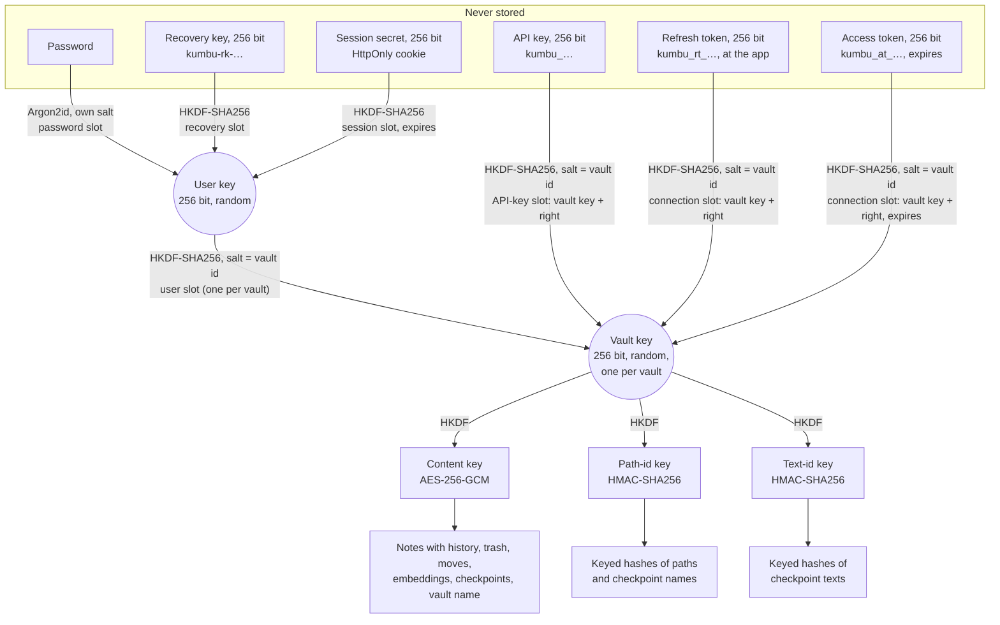
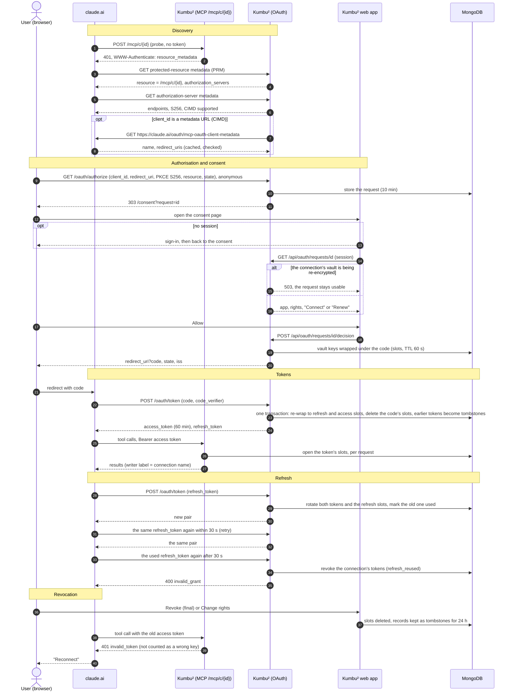
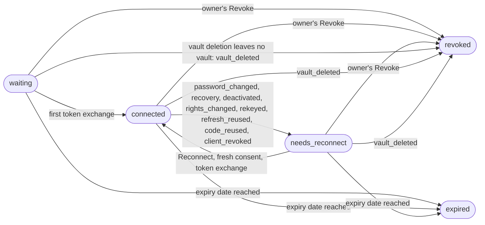

# Kumbu² — Security Architecture and Encryption at Rest

**Audience:** a technical decision-maker who decides whether employees' personal notes may live in Kumbu².
**Scope:** the code as built (accounts, API keys, web app, MCP endpoint; steps 1 to 9a, plus the step 9b fixes to the recovery key file, HSTS, the CSP, and what a password change and a recovery revoke; the overnight round's external embedding providers (§5.5), API-key expiry, deletion of vaults and accounts, optional MongoDB authentication and pinned build inputs; and step 10's connections, through which apps such as claude.ai sign in with OAuth 2.1, with Kumbu² as their authorisation server, §6, and new keys for an account and its vaults after a recovery or on request, §3). Everything that is only planned is in §9, "What comes next", and nowhere else.
**How to check it:** every key claim names the file (and, where useful, the line) in `src/` that implements it. The project is open source (AGPL-3.0-or-later). No external security audit has been done; the reviews so far were part of development.

## 1. Summary for a decision-maker

Kumbu² is a self-hosted Markdown notes server. People use it through a web app. AI agents and apps reach it in one of two ways, each made by the person for chosen vaults and rights: local agents (Claude Code and other MCP clients) with an **API key** on `/mcp`; apps that sign in with OAuth (claude.ai on the web, in the desktop app and on the phone, and others) through a **connection**, a connector URL of its own that the person pastes into the app and authorises there once, on Kumbu²'s consent page. Notes are personal: there is no sharing between users.

**What it protects well.** Everything in the database is encrypted: note text, its history, the trash, folder and file names, vault names, the search vectors and checkpoints. Each vault has its own random key, and that key is stored only *wrapped*: by its owner's user key, by each API key given that vault, and by each live token of a connection given it. The user key in turn is stored only wrapped by the owner's password, recovery key and web sessions. A database dump, a stolen backup or the disk of a compromised hoster shows no readable content and no paths, only metadata such as usernames and display names, the admins' notes on invitations ("for Lea"), sizes and times. Admins manage accounts but cannot read notes, cannot see vault or note names, and cannot reset passwords. After a suspected compromise a user can give their account and every vault new keys ("Re-encrypt my vaults"), and a recovery does so by itself. The vaults are re-keyed one after another in the background; once a vault's re-keying has finished, an old password, recovery key or API key reaches nothing written to that vault afterwards, apart from documents left damaged. Dev-token vaults are not covered (§3).

**What it does not protect against.** It is *encryption at rest*, not end-to-end encryption. To search, render and edit, the server decrypts a vault into memory while it is in use, and keeps it there until no caller has used it for 15 minutes (checked once a minute, so up to about 16). Signing out does not lock it, and an agent that keeps using a vault keeps it unlocked. Whoever controls the running server — the operator — can therefore read what is in use, and could change the server to capture passwords. The AI provider of a connected agent sees whatever that agent reads; for an app connected through a connection, the provider also holds the refresh token, key material to that connection's vaults (§2, §8). A vault whose owner opts in to an external embedding provider (off by default, per vault) sends the text of its sections and its search queries to that provider (§5.5). These limits are by design and stated, not hidden.

**What that means for COR.energy.**

1. The decisive question is **who operates the instance**. For employees' personal notes, the operator must be someone COR trusts with that content: COR's own platform team on COR's own infrastructure (the planned `kumbu.internal.cor.energy`), not a third party. On Chris's community instance `kumbu.tidesson.net`, Chris is the operator.
2. **Admins are not the threat** the design worries about: the admin role grants no access to content (§4).
3. **No password reset, by design.** A user who loses both password and recovery key loses their notes. This has to be accepted and communicated.
4. **AI use follows COR's AI policy.** What an agent reads goes to its model provider. Kumbu² limits *which* vaults an agent can reach (and whether it may write), not what the provider does with what it receives. The same holds for an external embedding provider, if the instance offers one: COR decides whether to configure one, and each owner whether a vault uses it (§5.5).
5. **Deletion is for good, but not from backups.** A leaving employee's account can be deactivated (`src/Kumbu.Server/Accounts/Admin.cs:54–90`), and an admin can delete any user but the primary admin and themselves, active or not, in one step, with the username typed out and their own password (for a privacy request, with a receipt that names no vault or note); a user can delete their own account (password and username) or a single vault (its name). Everything of it goes in one MongoDB transaction: vaults with notes, history, trash, checkpoints and search vectors, every slot, sessions, API keys and connections with their tokens (`src/Kumbu.Server/Accounts/Deletion.cs`, §6). Deactivating disconnects the user's apps as it revokes their keys. Backups taken before keep the sealed data, and with it whatever credentials were valid then (§7).

## 2. Threat model and honest limits

### What is protected, against whom

| Threat | Protected? | Why |
|---|---|---|
| Database dump, stolen backup, hoster's disk | Yes, content and names | All content and paths sealed with AES-256-GCM under per-vault keys; keys stored only wrapped (§5). |
| Another user of the same instance | Yes | A user's vaults open only with their user key; other users' vaults are invisible, not merely refused (§4). |
| An admin (in the app) | Yes, content | The admin role carries no key material; admin screens show metadata only (`src/Kumbu.Server/Accounts/Admin.cs`). |
| A stolen API key | Limited to its vaults and rights | Slots per vault, right sealed into the slot; revocation deletes the slots at once (§6). Revoking alone does not re-key the vault; re-encrypting it does (§3). |
| Cross-site attacks in the browser | Yes, as far as tested | `SameSite=Strict` cookie, `Origin` check, CSP, HSTS, no raw HTML in rendered Markdown (§7). |
| Online password guessing | Rate-limited | Per username and per address (§7). The per-username limit lets anyone who knows a username keep that user from signing in, minute after minute (a targeted lockout; keys and live sessions keep working). |
| Offline password guessing from a dump | Slowed, not prevented | Argon2id with 64 MiB per guess (§5); a weak password remains guessable. |

### What is not protected

- **The operator of the running server.** While a vault is unlocked, its notes, paths, search vectors and the vault key itself are in the server's memory in plain form (`src/Kumbu.Server/Vaults/UnlockedVault.cs`, `VaultCatalog.cs:827`). The operator can read process memory, and can deploy a modified server or web app that records passwords, session cookies and API keys as they arrive (passwords are sent to the server and derived there; nothing is derived in the browser). Users who do not trust the operator must run their own instance.
- **The AI provider** of a connected client sees what the agent reads and writes. This is not end-to-end encryption and is never described as such (`README.md`, "Security").
- **The app's provider holds a refresh token.** For an app connected through a connection (claude.ai and others), the token endpoint answers the provider's servers, not the user's device, so the provider (Anthropic, OpenAI, xAI…) keeps the connection's refresh token: key material that, with Kumbu²'s database, opens exactly that connection's vaults with its rights, until the connection expires or its tokens are revoked. That is consistent with the threat model, since the provider sees whatever it reads anyway, but it means a breach at the provider reaches those vaults without the user's password. Revoking the connection in Kumbu², or a password change that disconnects the apps, ends it (§6, §8).
- **An external embedding provider**, for a vault that opted in: it receives the text of every section and every search query of that vault, and what it keeps is its own promise (§5.5).
- **Rollback by someone with write access to the database.** An older genuine version of a document (from a backup) can be put back; it opens, because it is genuine. Detecting this needs a per-vault counter or manifest; not built (`docs/superpowers/specs/2026-10-23-encryption-design.md` §5).
- **Old copies of the database with old credentials.** Revoking a credential deletes its slot but changes no key; re-keying gives new keys, but cannot reach into a copy taken before it (§3). Whoever holds an old backup *and* a credential that was valid then (an old password, an old recovery key, a revoked API key) can open from it what it held. That reach is limited to data written before the vault's last re-keying: what was written afterwards is sealed under a key that no old credential opens, in a current dump or a later backup. A vault never re-keyed has no such limit. Restoring a backup brings back the credentials of that moment (§7).
- **Metadata.** The database holds, in the clear: usernames and roles, sign-in times, which vaults belong to which user, how many documents a vault has and their sizes, revision numbers and times (details in §5.6). An admin sees some of this by design.
- **Keys in memory are not zeroed.** Locking a vault drops the reference; the bytes stay until the .NET garbage collector reuses them (`VaultCatalog.cs:750`). The re-keying runner also holds a user key while one of that user's vaults waits for it (§3). Swap and core dumps of the server can hold plaintext; the operator should disable both on the host.

### How long plaintext lives in memory

A vault is decrypted **completely** the first time a request uses it (notes, history, trash, moves, embeddings, checkpoint index; `VaultCatalog.cs:827–899`) and served from memory afterwards. A sweep once a minute (`src/Kumbu.Server/Vaults/VaultSweeper.cs:9`) locks a vault after **15 idle minutes** (`Kumbu:Vaults:IdleMinutes`, `src/Kumbu.Server/KumbuOptions.cs:142`), so in practice after 15 to 16 minutes, and the least recently used vaults when all unlocked vaults together exceed a memory cap (default 512 MB, `KumbuOptions.cs:145`). A vault used in the last minute is never locked. Idle means *no caller* used the vault: the time counts across sessions and API keys together, so an agent that polls a vault keeps it unlocked (so does a visible web app tab with a note open, whose poll of the note's version reads it every 5 seconds, until its session ends, §6), and signing out or the end of a session does not lock it (`Vaults/UnlockedVault.cs:88`, `VaultCatalog.cs:758`). A restart locks everything; but because sessions and API keys live in the database (§6), the next request with a valid cookie or key unlocks the vault again without the user doing anything.

The unlocked cache never replaces authorisation: every request derives its own lookups and unwraps its own slot, and a cached vault is handed out only if the unwrapped key matches it (`VaultCatalog.cs:833–839`).

## 3. Keys and slots

### The hierarchy

Every user has a random 256-bit **user key**. Every vault has a random 256-bit **vault key**. Neither is ever stored in the clear. Each is stored in **slots**: the key, sealed with AES-256-GCM under a key-encryption key (KEK) derived from one credential. Opening a slot needs that credential; revoking a credential means deleting its slot. This is the same idea as LUKS key slots.



Why a user key in between: with five vaults and three credentials, direct slots would be fifteen to keep in step on every change. With the user key, a password change rewraps one slot, and a new vault is wrapped once (`docs/superpowers/specs/2026-10-24-accounts-and-web-design.md` §3).

### The slots as built

| Slot | Collection | KEK derivation | Associated data | Code |
|---|---|---|---|---|
| Password → user key | `user_slots` | Argon2id(password, 16-byte random salt) | `user:{userId}:password` | `Accounts/UserCatalog.cs:370–381` |
| Recovery key → user key | `user_slots` | HKDF(recovery key, `kumbu/v1/user-recovery-kek`, salt = user id) | `user:{userId}:recovery` | `UserCatalog.cs:383–392` |
| Session → user key | `user_slots` | HKDF(session secret, `kumbu/v1/session-kek`, salt = user id) | `user:{userId}:session` | `Accounts/Sessions.cs:45–80` |
| User key → vault key | `slots` | HKDF(user key, `kumbu/v1/user-slot-kek`, salt = vault id) | `slot:{vaultId}:user` | `Vaults/VaultCatalog.cs:194–291` |
| User key → the new vault key, during a re-keying (`user-next`, at most one per vault, beside the user slot) | `slots` | HKDF(user key, `kumbu/v1/user-slot-kek`, salt = vault id) | `slot:{vaultId}:user-next` | `Vaults/VaultCatalog.Rekey.cs:357–366`, `Vaults/VaultCatalog.cs:1024–1032` |
| API key → vault key and right | `slots` | HKDF(API key, `kumbu/v1/api-key-kek`, salt = vault id) | `slot:{vaultId}:key:{keyId}` | `VaultCatalog.cs:300–356` |
| Code → vault key and right (OAuth, one per vault of the connection; expires with the code after 60 s, TTL index) | `slots` | HKDF(code, `kumbu/v1/oauth-kek`, salt = vault id) | `slot:{vaultId}:connection:{connectionId}:{tokenId}` | `VaultCatalog.cs:368–376, 414–428, 942–946, 1023` |
| Refresh token → vault key and right (OAuth, one per vault of the connection; re-wrapped from the code's, and on every rotation from the previous refresh token's, whose slots are deleted; expires with the connection, no TTL for one without expiry) | `slots` | HKDF(refresh token, `kumbu/v1/oauth-kek`, salt = vault id) | `slot:{vaultId}:connection:{connectionId}:{tokenId}` | `VaultCatalog.cs:386–409, 414–428`, `OAuth/OAuthTokens.cs:295, 316–322, 434, 451, 459–465` |
| Access token → vault key and right (OAuth, one per vault of the connection; re-wrapped from the code's or the refresh token's; expires with the token, at most `Kumbu:OAuth:AccessTokenMinutes`, default 60, TTL index; refused past its expiry in code) | `slots` | HKDF(access token, `kumbu/v1/oauth-kek`, salt = vault id) | `slot:{vaultId}:connection:{connectionId}:{tokenId}` | `VaultCatalog.cs:386–409, 414–428, 435–445`, `OAuth/OAuthTokens.cs:296, 316–322, 435, 459–465, 648–649` |

(All paths relative to `src/Kumbu.Server/`.) Each derivation has its own label, so a value derived for finding a slot can never serve as a key for opening one. The per-vault and per-user salts mean one KEK opens exactly one slot. HKDF is used only for high-entropy secrets (random keys and tokens, and the dev token, which the operator chooses and which must therefore be random: the server checks only its length, `KumbuOptions.cs:8–17`, `Vaults/VaultCatalog.cs:76, 924`); Argon2id only for the password, the one low-entropy secret (`src/Kumbu.Core/Crypto/VaultCrypto.cs:54`).

**Finding a slot without storing the credential.** Sessions and API keys are found by a lookup value `HKDF(secret, "…-lookup")` stored next to the slot (`Sessions.cs:169`, `Accounts/ApiKeys.cs:344`); a user's vault slots by `HKDF(user key, "kumbu/v1/user-slot", salt = user id)` (`VaultCatalog.cs:929`). Since the secrets are 256 bits of randomness, a lookup value cannot be turned back into the secret, and guessing is pointless.

**Vaults of users have no recovery slot of their own.** The user's recovery key reaches them through the user key.

**The dev token** (a single server-wide bearer secret for local development, steps 1–7) has its own older slot kind on the vaults it created. It is optional: unset, it opens nothing (`KumbuOptions.cs:19–20`). It never had and cannot get a slot on a user's vault. A public instance runs without it (§7).

### Key rotation and re-keying

**Revoking a credential changes no key.** Revoking an API key deletes its slots (`Accounts/ApiKeys.cs:187–208`), a password change wraps the same user key under the new password (`Accounts/UserCatalog.cs:268–319`), and a new recovery key wraps the same user key (`UserCatalog.cs:224–243`). So an old backup, together with a credential that was valid when it was taken, opens what that backup holds, and a vault key exposed once opens every later copy of the vault until the vault is **re-keyed**. Re-keying comes in two stages, the user key and then each vault (design and measurements: `docs/superpowers/specs/2026-10-26-rekeying-design.md`).

**Stage 1: a new user key** (`Accounts/UserKeyRotation.cs`). A new random user key replaces the old one, in one transaction, with everything that hangs on it (`UserKeyRotation.cs:121–142, 195–286`):

- the password slot, sealed again under the password at hand with a new salt;
- a **new recovery key**, shown once. Outside a recovery the old recovery key isn't at hand, so its slot can't be sealed again, and left as it is it would open a user key that no vault slot uses any more;
- the current session's slot if one is kept; every other session ends;
- each vault slot of the user, with its lookup value and its vault name hash;
- the sealed names and rights of the user's API keys and connections, revoked ones included, with their name hashes;
- `users.keyId`, the credentials stamp, and every vault of the user in `users.rekeyPending`, for stage 2.

Argon2 and the resealing run before the transaction (`UserKeyRotation.cs:80–112`). Each write is conditional on the value it was prepared from, and the transaction checks that no slot under the old lookup value is left and that the user has exactly the API keys and connections that were prepared; on any mismatch it aborts and is prepared again, three times at most, then answers 409 (`UserKeyRotation.cs:150–177, 243–286`). A crash therefore leaves the password and the vault slots opening with one key: the old one before the commit, the new one after it. A slot that matched but didn't open, or an API key's or connection's sealed name that doesn't open, is left as it is and logged; it opened nothing before either.

**`users.keyId` guards every write under a user key.** A sign-in can read the old password slot just before a rotation commits, and then holds the old user key with a read time after the stamp. So each transaction that writes something under the user key and writes the user document requires `keyId` to be the one derived from the key it uses, else 401: starting a session, creating a vault, an API key or a connection, changing a connection's rights, and the consent's code issuance (`Accounts/Sessions.cs:49, 71`, `Vaults/VaultCatalog.cs:247, 1052–1059`, `Accounts/ApiKeys.cs:103, 132`, `Accounts/Connections.cs:110, 136, 237–243`, `OAuth/OAuthTokens.cs:187–188`). A password change or a new recovery key replaces its slot only if the password slot is still the one it opened, so neither wraps the old user key again after a rotation; a lost race answers 409 (`UserCatalog.cs:167–180, 224–243`).

**Stage 2: a new key for each vault** (`Vaults/VaultCatalog.Rekey.cs`). A vault gets a new random vault key K′, and everything sealed under its key K is sealed again under K′: notes with their history, trash, moves, embeddings, checkpoints and checkpoint texts, with their keyed hashes (`pid`) recomputed, and the vault's name. One transaction would not fit a large vault: everything a MongoDB transaction rewrites must stay in the database's cache until it commits, and on a 256 MB cache a vault of 2000 notes (40–80 MB) is more than one transaction can rewrite. So a run has a **two-key period**, between two short transactions:

- **Start** (`VaultCatalog.Rekey.cs:327–399`): K′ goes into a `user-next` slot beside the owner's user slot (§3, "The slots as built"); the vault document gets `rekeyStartedAt`; every API key with a slot on the vault is revoked whole, its name freed and its slots on every vault deleted, since the server can't wrap K′ for a key it doesn't hold; every connection that lists the vault loses its tokens and needs a reconnect (`rekeyed`); every other slot on the vault but the owner's two is deleted; and the vault goes into `rekeyPending`. The start requires `users.keyId` to match the user key it runs with (`VaultCatalog.Rekey.cs:336–343`).
- **Batches** (`VaultCatalog.Rekey.cs:464–567`): each collection of the vault is read from MongoDB and sealed again under K′ in transactions of at most 500 documents or 4 MiB of sealed bytes (`VaultCatalog.Rekey.cs:88, 91`), each write conditional on the blob that was read. Passes repeat until one finds nothing to change, at most 10 (`VaultCatalog.Rekey.cs:49, 468–480`); past that the run gives up with "being re-encrypted", the vault stays in its two-key period, and the runner tries again after its backoff. A document that opens under neither key is **damaged**: it is left as it is, counted and logged (`VaultCatalog.Rekey.cs:584`).
- **Finish** (`VaultCatalog.Rekey.cs:407–458`): the user slot wraps K′, the `user-next` slot goes, the vault's name is sealed under K′, `rekeyStartedAt` is unset and the vault leaves `rekeyPending`.

A crash at any point leaves every document under exactly one of K and K′, or damaged, and the next run resumes with the key in the `user-next` slot. Meanwhile the vault answers as a placeholder: name lists keep it, a request for it answers 503 "This vault is being re-encrypted; try again in a moment." with `Retry-After: 5`, and searches across vaults leave it out (`Vaults/VaultCatalog.cs:857`, `Vaults/EncryptedNoteStore.cs:552–567`, `Api/ApiErrors.cs:66–70`). A session's listing of its vaults that read a user slot just before a finish committed, and loads the vault just after it, holds K while the vault is under K′; it reads that slot once more and loads the vault with K′, so a list of vaults, keys or connections, or the consent page, doesn't answer 503 "This vault was just re-encrypted" right after a recovery, a sign-in or a re-encryption; a second failure does (`Vaults/VaultCatalog.cs:147–163`). API keys and connections have no such window: the start deleted their slots on the vault. The consent page also tries its request once more after a 503 (`web/src/routes/Consent.tsx:53–62`).

**Nothing in this process writes a vault during its run.** Every object of a vault shares one pair of locks, for writes and for indexing, and a run holds both from its start to its finish (`VaultCatalog.Rekey.cs:221–246`). Every write and every indexing checks, before waiting for its lock and again under it, that no run holds the vault, that the vault is not in its two-key period, and that the object was made with the vault's current key; else 503 (`VaultCatalog.Rekey.cs:117–126`). Against a writer outside the locks (another process, a bug), the writes and deletes of a note also filter on its `pid`, which a resealed note no longer has under K, so such a write matches nothing instead of destroying the note (`Vaults/EncryptedNoteStore.cs:539–540`). Old keys can't escape into new slots either: an API key or an app's code whose slots were wrapped from a user slot before a start or a finish is refused inside its own transaction (`VaultCatalog.Rekey.cs:143–163`), and a vault in its two-key period gives no key to a new slot at all (`Vaults/VaultCatalog.cs:300–332`).

**The runner** (`Vaults/RekeyRunner.cs`) runs stage 2 in the background: one vault at a time for the whole process, from one queue, so that runs don't multiply the cache their batches need (`RekeyRunner.cs:134–155`). An attempt that takes longer than 30 minutes counts as failed (`RekeyRunner.cs:37, 157–197`); after the n-th failure in a row the vault waits min(2ⁿ⁻¹ minutes, 1 hour) before it is tried again (`RekeyRunner.cs:206–236`). A trigger for a vault whose run is under way hands its user key to the next attempt; if that key is a newer one (a rotation committed mid-run, so the run under way fails with the replaced key), a failure is tried again at once with the newer key instead of backing off with the old one (`RekeyRunner.cs:113–121, 172–176, 221–227`). A restart loses the queue, not the state: `rekeyPending` and `rekeyStartedAt` stay in the database, and the user's next sign-in, or a request that meets the vault, starts it again (`Api/AccountApi.cs:141`, `Vaults/VaultCatalog.cs:166`, `Accounts/Rekeying.cs:82–99`).

**When it runs:**

- **A recovery** rotates the user key in the transaction that sets the new password and the new recovery slot, answers with the new recovery key at once, and hands every vault to the runner (`UserCatalog.cs:134–158, 300, 327–347`, `Api/AccountApi.cs:185–193`). Until its run starts, a vault keeps working under its old vault key, whose user slot the rotation already wrapped under the new user key.
- **"Re-encrypt my vaults"** in Settings (`POST /api/account/reencrypt`, with the password): stage 1, keeping the current session and ending every other one; then, before the answer, every API key of the user is revoked and the tokens of every connection (`rekeyed`); the answer carries the new recovery key; then the runner re-keys each vault (`Accounts/Rekeying.cs:27–56`, `Api/AccountApi.cs:114, 234–242`).
- **"Re-encrypt vault"**, per vault in Settings (`POST /api/vaults/{vault}/rekey`, with the password, which is checked before the name is looked up): the request waits for that vault's run, behind any other vault in the queue. Before the user confirms, the page lists the API keys and apps that will lose access (`GET /api/vaults/{vault}/access`; `Api/NoteApi.cs:122–123, 208–226`, `Accounts/Rekeying.cs:64–75, 103–115`).

**What it protects.** An old backup keeps what it held, and whatever opened it then still opens it there. But data written after a vault's re-keying is sealed under K′, which no old credential reaches: an old password or recovery key opens the old user key, which opens no current slot, and a revoked API key's slot never held K′. A vault key exposed once, through a revoked key's slot in a backup say, opens nothing written after the vault's re-keying.

**Limits and windows:**

- **The runner holds a user key in memory** while one of that user's vaults is queued, running or waiting after a failure, so that it can carry on without the user (`RekeyRunner.cs:46–65`). Otherwise the server holds a user key only while a request uses it. Keys in memory are not zeroed (§2).
- **A crash between stage 1's commit and the revocation** in "Re-encrypt my vaults" leaves the API keys and the apps' tokens live until stage 2 reaches their vaults: every key and connection has a vault, every vault is pending, and each start revokes what has a slot on its vault. The same holds if the revocation fails; that is logged as an error, and the new recovery key is answered all the same (`Rekeying.cs:32–54`).
- **Damaged documents may stay under the old key**, with whatever clear fields they have; whoever holds K might open one by restoring its original fields. They were already unreadable to the user, and the run logs each.
- **A password change alone does not rotate**: it wraps the same user key under the new password. After a suspected compromise, re-encrypt; if the password itself may have leaked, change it too.
- **Re-keying revokes API keys whole**, with their other vaults, and connected apps need a reconnect: the server can't wrap a new vault key for a credential it doesn't hold. The agents and apps still in use need new keys or a reconnect.
- **Dev-token vaults can't be re-keyed**: they have no owner's user slot (`VaultCatalog.Rekey.cs:331–334`).
- **Re-keying assumes a single server process.** The locks, the key checks and the runner live in memory, as the working set does (§9). A writer in another process meets the `pid` fences and fails instead of destroying a note, but a new document it inserts stays under K and shows as damaged.
- **While a vault is mid-re-key**, creating an API key or a connection for it, changing a connection's rights to include it, and Allow on the consent page for a connection that lists it answer 503, as reads and writes of it do (`Vaults/VaultCatalog.cs:327`, `Api/ConnectionApi.cs:107–108`).
- **The batch size was measured on mongod 7.0.14** with a 256 MB cache (2000 notes with history and embeddings, 49 MiB, re-keyed in 16 batches of at most 4 MiB in about 7 s), not on `mongo:8`, which the shipped Compose file runs (`compose.yaml:3`).

## 4. Who can do what

| Actor | Can | Cannot |
|---|---|---|
| **The user** | Everything with their own vaults: read, write, upload, search, history, checkpoints; create and revoke API keys (optionally expiring), and connections for apps that sign in with OAuth (optionally expiring; their rights can be changed, which makes the app reconnect); change password, make a new recovery key (needs the current password), sign out other sessions; give the account and every vault new keys, or one vault a new key (both need the password, §3); delete a vault (password and its name typed out) or the whole account (password and username typed out; not the primary admin). | See other users or their vaults. A user's `ls /` does not even count vaults that aren't theirs (`Vaults/Credentials.cs:24–31`). |
| **Admin** (role `admin` or `primary_admin`) | See the user list: username, role, active, created, last sign-in, number of vaults, bytes stored (`Accounts/Admin.cs:25–44`). Create and revoke invitations (role `user` or `admin`). Deactivate and reactivate users (ends their sessions, revokes their API keys and disconnects their apps at once, `Admin.cs:54–90`). Change roles, except the primary admin's. Delete any other user, active or not, in one step, never the primary admin and not themselves (they use Settings), with the username typed out and their own password: their vaults and everything in them go without being opened, and the admin gets a receipt of ids, usernames, the time and counts (`Accounts/Deletion.cs:89–108`). | Open any vault, see vault names, note names or content, reset a password, recover an account. There is no code path from the admin role to key material. *Limit:* a stolen admin session cannot delete anyone (that needs the admin's password), but it can invite a new admin account that outlives the session; it still opens nobody's vaults. |
| **Operator** of the running instance (root on the host, access to the container, the image or the deployment) | Read process memory, so every vault while unlocked. Change the server or web app to capture passwords, cookies and API keys as they arrive, and from them user keys. Read the database, logs and backups. | Read a vault whose owner never signs in and whose keys are never used while the operator is acting maliciously: without the credential, the slot does not open. |
| **Database dump or stolen backup** (read access) | See metadata (§5.6). Run offline guesses against each user's password slot at the cost of one Argon2id (64 MiB, 3 passes) per guess per user. | Read content, paths, vault names, checkpoint names, API key names. Recover API keys, session secrets or recovery keys from their lookup values. |
| **Database write access** | Delete data. Put back older genuine documents (rollback, §2). Change roles or the active flag; insert an invitation (the instance secret that keys invitation codes is in the database, `Accounts/ServerSecret.cs`) and so create an account. | Make a modified or moved document open: a changed byte, a blob copied to another document or vault, a changed right in an API-key slot, or a swapped path hash is rejected (`UnlockedVault.cs:104–117`; `tests/Kumbu.Server.Tests/Vaults/EncryptedNoteStoreTests.cs:533`). Gain access to an existing user's vaults. |
| **Stolen API key** | Read, or read and write, exactly the vaults it was given, through MCP (`/mcp`) and the note endpoints of the REST API, from anywhere, until revoked. Its writes carry the key's name in the history. With write rights, also remove checkpoints for good: `rmcp`, or `DELETE /api/vaults/{vault}/checkpoints/{name}` (what the web app's Remove sends), deletes the checkpoint document, with no trash (`src/Kumbu.Core/Notes/Checkpoints.cs:139–153`, `Api/HistoryApi.cs:72, 196–202`, `Vaults/EncryptedNoteStore.cs:342–360`); restoring a checkpoint or an earlier version, by either way, is a new write that keeps what it replaces in the history (`src/Kumbu.Core/Notes/NoteWriter.cs:312`, `Checkpoints.cs:476–489`). | Reach other vaults; create or delete vaults; manage keys, the account or users (session-only endpoints answer 403, `Api/Security.cs:88–92`). Write to a read-only vault. Delete notes beyond recovery: a deleted note is in the trash for 30 days, and up to 10 earlier versions per note are kept (`src/Kumbu.Core/Notes/NoteWriter.cs:19–20`), though a key with write rights can push old versions out by writing repeatedly. A key expires only if its owner chose an expiry at creation (30, 90 or 365 days; the web app proposes 90). |
| **Lost or stolen laptop** | Use a browser session that is still valid (at most 30 idle minutes, 12 hours in all), and within that session create new API keys (write, any of the user's vaults) that outlast the session, until revoked; a password change revokes them unless the user unticks that (`Api/AccountApi.cs:34–37, 117`, §6). Likewise create a connection (write, any of the user's vaults) and authorise an app of the finder's own for it, whose refresh token outlasts the session until the connection is revoked or expires, or a password change that revokes the API keys disconnects it too (§6). Such a session alone cannot delete a vault or the account: both need the password (`Api/NoteApi.cs:121`, `Api/AccountApi.cs:113`). Use any API key stored in an agent's configuration (for Claude Code, in its local settings, in plain text) until it is revoked. **If the downloaded recovery key file is on the laptop and the finder knows the username**, take over the account. The file, `kumbu-recovery-key.txt`, holds only the key and a short instruction (keep it somewhere safe, not on this device; together with the username it opens the account; it is shown only once), but neither the username nor the instance's address (`web/src/components/RecoveryKeyReveal.tsx:25–34`), so the file alone is not enough. A username is not a secret, though: it may be the e-mail prefix or known to colleagues. | Read notes from browser storage: the web app keeps no note content and no secrets in local or session storage (local storage holds only the colour scheme, `web/src/theme/apply.ts`, and whether Read mode takes a change made elsewhere by itself, `web/src/note/autoRefresh.ts`; session storage only a flag for the one automatic reload after an update, `web/src/components/AppError.tsx:9–36`; tested in `web/src/note/MarkdownEditor.test.tsx`, `web/src/routes/Keys.test.tsx:189`; the consent page, which receives the authorisation code in the answer to Allow, holds no token and writes nothing to either storage, and keeps neither its request nor that answer in the query cache: `gcTime: 0` at `web/src/routes/Consent.tsx:58` and `:65`, tested in `web/src/routes/Consent.test.tsx:186–203`), and API responses are `Cache-Control: no-store` (`Api/Security.cs:55`). |
| **Stolen access or refresh token** (of a connection) | An access token: read, or read and write, exactly its connection's vaults with the consented rights, through MCP on that connection's URL `/mcp/c/{id}` only, until it expires (at most an hour by default) or the connection's tokens are revoked. A refresh token: nothing by itself on any URL; with the token endpoint's refresh grant it yields new access tokens until the connection expires or its tokens are revoked, and if the app refreshes too, the second use of a spent token revokes them (§6). Writes carry the connection's name. | Use an access token on `/mcp`, on the REST API or on another connection's URL (401); open anything once its slots are deleted or past their expiry, whatever is in memory (`Auth/CallerMiddleware.cs:135–190`, `OAuth/OAuthTokens.cs:683–724`, `Vaults/VaultCatalog.cs:386–409`; tested in `tests/Kumbu.Server.Tests/OAuth/TokenTests.cs`). Manage keys, connections, the account or users. |
| **AI provider** (e.g. Anthropic for Claude) | See everything its agent reads or writes through Kumbu², as part of the conversation, under the provider's own data terms. With a connector (claude.ai and similar), the provider's servers hold the connection's refresh token, which carries slots on the granted vaults: key material at the provider, consistent with the fact that it sees their content anyway (§8). | Reach vaults the API key or connection wasn't given. With Claude Code, the MCP connection is made from the user's machine and the key sits in its local configuration, so it is not normally sent to the provider. This holds by the design of the set-up, not by enforcement: the agent can read its own configuration files. |

**What to do after a lost laptop:** from another device, sign in and run **"Re-encrypt my vaults"** in Settings (`POST /api/account/reencrypt`, with the password, §3). It ends every other session, revokes every API key and disconnects every app before it answers, so the keys a session on the laptop may have made die too, not only those that were on the laptop, and an app the finder authorised is disconnected; it replaces the recovery key, so a recovery key file left on the laptop opens nothing any more; and it gives the account a new key at once and then each vault a new key in the background, one after another (a vault shows as "Being re-encrypted" until its turn is done). Once a vault's re-keying has finished, what the user writes to it is out of reach of anything copied from the laptop or the database before, apart from documents left damaged (`Accounts/Rekeying.cs:27–56`, §3). If the password may have leaked too (typed or saved on the laptop), change it as well: re-encrypting keeps it, and a password change alone does not rotate the keys. A password change with "Also revoke all API keys and disconnect apps" ticked, as it is by default, also revokes every key and disconnects every app (`Api/AccountApi.cs:34–37, 210`, `Accounts/UserCatalog.cs:284–289, 311–315`), but does **not** replace the recovery key (`Accounts/UserCatalog.cs:167–180`; README, "Accounts, API keys and the REST API"). Then give the agents still in use new keys, reconnect the apps still in use (their connections list as needing a reconnect; Reconnect in the app renews each after a fresh consent), and revoke any connection in the list that the user doesn't recognise. Recommendation for users: keep the recovery key in a password manager and delete the downloaded file.

## 5. Encryption at rest in detail

### 5.1 Primitives

All from .NET itself (`System.Security.Cryptography`), except Argon2id:

| Purpose | Primitive | Parameters | Code |
|---|---|---|---|
| Sealing (encrypt and authenticate) | AES-256-GCM | 256-bit key, 96-bit nonce, 128-bit tag | `src/Kumbu.Core/Crypto/VaultCrypto.cs:27–36` |
| Deriving keys from random secrets | HKDF-SHA256 | 256-bit output, a distinct label per purpose, salt where a key must be bound to one vault or user | `VaultCrypto.cs:55–60` |
| Keyed hashes | HMAC-SHA256 | key derived from the vault key | `VaultCrypto.cs:65` |
| Password → KEK | Argon2id (Konscious.Security.Cryptography.Argon2 1.3.1) | **64 MiB memory, 3 iterations, parallelism 4**, 16-byte random salt per password slot, 32-byte output; NFC-normalised password | `src/Kumbu.Server/Accounts/Argon2Kdf.cs:11, 17–18, 69–76` |
| Random keys, nonces, secrets | `RandomNumberGenerator` (OS CSPRNG) | 32 bytes for every key and secret | `VaultCrypto.cs:20, 32` |

The Argon2id setting is the second recommended option of RFC 9106; it is above OWASP's current minimum. To keep sign-in floods from exhausting memory, at most one Argon2 run per CPU core happens at once across the process; the rest wait (`Argon2Kdf.cs:20–26`).

**Sealed blob format:** one format byte (`1`), the 12-byte nonce, the ciphertext, the 16-byte tag (`VaultCrypto.cs:18, 27–36`). The nonce is **fresh random for every seal**; nothing reuses a nonce deliberately. With random 96-bit nonces, the usual bound is about 2³² seals per key; one vault's content key is far from that in personal use.

### 5.2 Context binding (associated data)

Every blob is sealed with associated data that names what it is. A blob only opens in exactly that context:

| Document | Associated data |
|---|---|
| Note (with its history) | `note:{vaultId}:{documentId}:{revision}` |
| Trashed note | `trash:{vaultId}:{documentId}` |
| Move record | `move:{vaultId}:{documentId}` |
| Embeddings of a note | `embeddings:{vaultId}:{pathId}` |
| Checkpoint | `checkpoint:{vaultId}:{documentId}` |
| Checkpoint text | `cptext:{vaultId}:{textId}` |
| Vault name, with the vault's embedding provider | `vault:{vaultId}` |
| Slots | see §3 |
| API key's name and vaults (owner's list) / its writer label | `api-key:{keyId}:meta` / `api-key:{keyId}:writer`, for a key with an expiry `api-key:{keyId}:writer:{expiry in Unix milliseconds}` |

(`src/Kumbu.Server/Vaults/UnlockedVault.cs:104–213`, `VaultCatalog.cs:116, 935–940`, `Accounts/ApiKeys.cs:350–354`.)

Consequence: someone with write access to the database cannot move a note, its embeddings or a checkpoint into another document, another vault or another revision, nor swap their clear fields around: it fails to open. On opening, the path inside the sealed note must also match the clear path hash (`UnlockedVault.cs:108–117`), likewise for embeddings and checkpoints. A document that fails is reported as damaged, never shown. The clear fields of trash and move records (the path hash, the deletion or move time) are *not* bound into the seal (`UnlockedVault.cs:123–138`): changing them can mislabel an entry or make the TTL index remove it earlier, which amounts to deleting it, something write access to the database allows anyway.

### 5.3 Sealed paths and names

Paths, file names and folder names exist in the database only inside sealed blobs. For MongoDB's unique index and lookups each document carries a **keyed hash** of its path, `HMAC-SHA256(HKDF(vault key, "kumbu/v1/path-id"), path)` (`UnlockedVault.cs:101`). Equal paths give equal hashes within a vault; without the vault key nothing else can be learned, not even whether two vaults hold the same path. Vault names are sealed (`VaultCatalog.cs:236`); their per-user uniqueness uses a keyed hash under the user key (`VaultCatalog.cs:207`). API key and connection names are sealed under the user key (`ApiKeys.cs:111`, `Accounts/Connections.cs:117`), and their uniqueness also uses a keyed hash, one for both (`Accounts/WriterNames.cs:50–51`, label `kumbu/v1/api-key-name-id`): a user's names are unique across API keys and connections together. Each collection has its own partial unique index (`ApiKeys.cs:369–373`, `Connections.cs:434–438`), and each creation checks the other collection inside its transaction (`ApiKeys.cs:138`, `Connections.cs:140`), which also writes the user document, so two creations with one name at once conflict and the retried one sees the other (`tests/Kumbu.Server.Tests/Accounts/ConnectionTests.cs:108`). Checkpoint names are keyed hashes too (`UnlockedVault.cs:176`).

### 5.4 History, trash, moves and checkpoints

- **History:** up to 10 earlier versions per note are kept **inside** the note's sealed blob (`src/Kumbu.Core/Notes/NoteWriter.cs:19`; `UnlockedVault.cs:324–326`), so the database does not even show how many versions exist, only the blob's size.
- **Trash and move records** are sealed documents of their own, removed by MongoDB TTL indexes after 30 days (`VaultCatalog.cs:984–995`).
- **Checkpoints** (named snapshots of a folder) store each note text once per vault, under a keyed hash of the content (`UnlockedVault.cs:179`). Which checkpoint refers to which text is recorded only inside the sealed checkpoint (`UnlockedVault.cs:181–184`), so a database reader cannot tell whether two checkpoints share a text; visible are the number and sizes of the distinct texts per vault.
- Deleting in MongoDB is not secure erasure: removed documents may persist in storage files and backups, but sealed. This holds for a deleted vault or account too (§6, "Deleting vaults and accounts").

### 5.5 Search and embeddings

Full-text search runs over the decrypted notes in memory. Search by meaning uses an embedding model. **By default, and for every vault whose owner has not chosen otherwise**, that is the internal model (Snowflake Arctic Embed, `arctic-m` or `arctic-l`), which runs **inside the server process** with ONNX Runtime: no note leaves the server to be embedded. The model is downloaded once from Hugging Face at a pinned revision and checked against a SHA-256 per file while downloading (`src/Kumbu.Server/Search/OnnxEmbedder.cs:79–122`, `ModelFiles.cs:20`). At later starts only the file sizes are checked (`OnnxEmbedder.cs:86`): a model file replaced on the volume by one of the same size would be loaded, so the model volume must be as trusted as the image. The vectors are stored per note as 16-bit floats inside a sealed blob (`UnlockedVault.cs:142–173`); embeddings can leak content if exposed, so they get the same protection as the text. There is no vector database and no external search service.

#### External embedding providers (opt-in per vault)

The admin of an instance can configure external embedding providers, services with the OpenAI embeddings API such as TensorX (`Kumbu:Embeddings:Providers:<name>`, README "External embedding providers"). Configuring one sends nothing anywhere. Each vault's **owner** decides, in the vault's menu, whether that vault uses one of them; the default stays internal (`Vaults/UnlockedVault.cs:68`).

- **What leaves the server, when, to whom.** For a vault that uses an external provider: the text of every section of every note (its note title, heading path and content, as `Chunker` builds it; the same text the internal model gets), sent when the vault is switched (all of its notes) and afterwards whenever a section's text changes; and **every search query** that covers the vault, when it is made. They go to the configured `BaseUrl` in a `POST …/embeddings` request with the configured model, over HTTPS (`Search/OpenAiCompatibleDriver.cs:112–117`). Nothing of the vault's other data goes there: no history, trash, checkpoints, file or vault names other than the note titles inside section texts, no user data. The vectors that come back are sealed and stored like the internal model's. The notes of other vaults, of the same user or others, are not sent (a search across vaults that includes this one does send its query, as above): each vault is indexed by its own provider's queue (`Search/SearchIndex.cs:34, 46`) and searched with its own provider's query vector (`Vaults/EncryptedNoteStore.cs:204, 280`).
- **The provider's retention is the provider's promise.** The admin can describe a provider (e.g. "EU, zero data retention"), and the web app shows that description before the owner switches, with the sentence that Kumbu² can't check or enforce it (`web/src/shell/EmbeddingsDialog.tsx`). What the provider keeps, logs or trains on is governed by its terms with whoever holds the API key (the operator), not by Kumbu². Switching back to internal stops further sending; what was sent stays under the provider's terms.
- **Who can choose.** Only a web session of the owner (`PUT /api/vaults/{vault}/embeddings` is session-only, and a session opens only its user's own vaults; `Api/NoteApi.cs:125, 165`). API keys, the dev token and admins cannot. The choice is sealed with the vault's name in the vault's meta (`UnlockedVault.cs:120`, `VaultCatalog.cs:782`), so someone with write access to the database cannot point a vault at a provider; they could, as with any document (§2, rollback), put back an older genuine meta, which restores the choice that vault had then.
- **Only safe transport, failing closed.** At startup the server refuses a provider whose `BaseUrl` is not `https://` (plain HTTP only to a loopback address, a model on the same machine), whose key file is missing, unreadable or empty, or whose driver is unknown (`KumbuOptionsValidator.cs:92–142`).
- **The API key.** Read from a file (`ApiKeyFile`, e.g. a Docker secret under `/run/secrets/`), never from an environment variable or the configuration itself, once at startup (`KumbuOptions.cs:110`, `Search/IEmbeddingDriver.cs:114`); a new key needs a restart. It is sent only as the `Authorization: Bearer` header of requests to that provider's `BaseUrl` (`OpenAiCompatibleDriver.cs:113`), and never logged; validation errors name the file's path, never its content.
- **No text in logs or errors.** The driver logs the provider's name, the HTTP status or the kind of network error, and the attempt; it never reads an error response's body, which may quote the input (`OpenAiCompatibleDriver.cs:120`), and its exception messages carry no text. HttpClientFactory's per-request log lines are lowered to warnings, so the log does not record when someone searched (`Program.cs:35`). Tested in `tests/Kumbu.Server.Tests/Search/OpenAiCompatibleDriverTests.cs` (`Neither_the_key_nor_a_text_reaches_the_log_or_an_error`).
- **When the provider fails.** For indexing, timeouts, 408, 429 and 5xx are retried with exponential backoff (honouring `Retry-After`, at most 16 s a wait). A search waits at most 5 s for a provider, with one retry after half a second unless the provider asks to wait longer, and asks all providers in its scope at once; then it ranks that provider's vaults by words. When indexing keeps failing, the provider pauses for a minute (a failed search pauses only the searches, so it never holds up the index): its vaults' notes are ranked by words, also in a search across vaults, where they are merged with the other vaults' ranking by meaning by reciprocal rank fusion (`src/Kumbu.Core/Search/SectionSearch.cs`, `FuseByRank`), with a notice naming the vaults (a search by meaning only leaves them out and says so); its notes wait in its queue (`OpenAiCompatibleDriver.cs:152, 185`, `SearchIndex.cs:105`). A provider the admin removes leaves its vaults without search by meaning, never silently switched to another provider, until the owner picks one.

`Kumbu:Search:Enabled=false` switches off the internal model only; vaults that opted in to an external provider still search by meaning.

### 5.6 What is in the clear

Verified against the document classes in `src/Kumbu.Server/Vaults/Documents.cs`, `Accounts/UserDocuments.cs`, `Accounts/ApiKeys.cs:418–458`, `Accounts/Connections.cs:587–638`, `OAuth/OAuthClients.cs:190–209`, `OAuth/AuthorizationRequests.cs:99–131`, `OAuth/OAuthTokens.cs:798–877` and `Accounts/Invitations.cs`; the test `Nothing_readable_reaches_the_database` (`tests/Kumbu.Server.Tests/Vaults/EncryptedNoteStoreTests.cs:48`) checks a full dump for paths, names and content.

| Collection | In the clear |
|---|---|
| `users` | username, display name (as typed), role, active, created, last and previous sign-in, last credential change, number of API keys, connections, vaults and sessions created (`keysCreated`, `connectionsCreated`, `vaultsCreated`, `sessionsStarted`), how often the user changed a connection's rights (`connectionsChanged`) and how many deletions took vaults of theirs (`vaultsDeleted`), counters that exist so that concurrent transactions conflict (§6, "Deleting vaults and accounts"), a key id derived from the user key, which every write under the user key checks (§3), the ids of the user's vaults still to be re-keyed (`rekeyPending`) and how many re-keying starts and finishes there were (`vaultsRekeyed`, a counter for the same reason) |
| `user_slots` | user id, kind, Argon2 salt, lookup value, wrapped key, created, and for sessions expiry and last use (so: how many sessions a user has, and when they were used) |
| `vaults` | random vault id, creation time, and while a re-keying is under way when it started (`rekeyStartedAt`) (the vault's name and embedding provider are sealed in its meta) |
| `slots` | vault id, kind (`user-next` shows that a vault is being re-keyed, §3), lookup value, **owner's user id** (user slots, so admins can count vaults per user), keyed name hash, API key id, for a connection's token the connection id, the token's record id and its expiry, wrapped key, created |
| `notes`, `trash`, `moves`, `embeddings`, `checkpoints`, `checkpoint_texts` | vault id, keyed hash, revision number, blob (whose size shows), deletion and move times; MongoDB's ObjectIds also carry their creation time. Counts per vault follow. |
| `api_keys` | owner's user id, lookup value, **the first 8 characters of the key** (so the owner can tell keys apart; about 48 of its 256 bits, leaving about 208 unknown), keyed name hash, created, last used, revoked, expiry |
| `connections` | random connection id (it is also in the connector URL), owner's user id, keyed name hash, **the ids of the vaults it covers** (so a vault's deletion reaches it while it has no slots), created, last used, expiry, revoked and tokens revoked with their reasons (`rekeyed` among them: a vault of the connection was re-keyed), authorised, how many times slots were wrapped for its codes and tokens (`wraps`, a counter for the same reason) (name, rights and the authorised app's name are sealed in its meta under the user key, `Connections.cs:117`; checked by `Nothing_readable_about_a_connection_reaches_the_database`, `tests/Kumbu.Server.Tests/Accounts/ConnectionTests.cs:372`) |
| `oauth_clients` | id, **name and redirect URIs of self-registered apps** (as the app sent them, cleaned of control characters), created, and an expiry that is unset once an authorisation succeeded; no secret is ever issued (`OAuth/OAuthClients.cs:190–209`) |
| `oauth_requests` | pending authorisations, for 10 minutes: random request id, client id, redirect URI, the app's `state`, the PKCE code challenge (a hash of the app's secret verifier), the `resource` as sent and the connection it names, read-only flag, problem, expiry (`OAuth/AuthorizationRequests.cs:99–131`) |
| `oauth_tokens` | per code, access token and refresh token: random record id, kind, connection id, owner's user id, client id, lookup value, created, expiry, used, the record it was issued from (`parent`) and, for a code, the refresh token it issued (`issued`); until 10 minutes after a code's expiry its redirect URI, PKCE challenge and read-only flag; an access token's record stays 24 hours after it expired (its slots don't), a refresh token's until the connection's expiry, and once used 30 days after its use, with the pair it was rotated into sealed under a key derived from it (`successor`) until that pair's refresh token is used in turn; a revoked or replaced one stays 24 hours as a tombstone with `revokedAt` and its lookup value but no grant and no slots (§6). The connection's name, its URL, its expiry and the code's or token's own expiry are sealed in each record's *grant* under a key derived from its own code or token, so no code or token is stored (`OAuth/OAuthTokens.cs:798–877`; checked by `The_code_wraps_the_vault_keys_for_a_minute`, `tests/Kumbu.Server.Tests/OAuth/AuthorizeTests.cs`) |
| `invitations` | keyed hash of the code, role, **the admin's note** ("for Lea"), who created and who used it, times |
| `server` | a random instance secret that keys the invitation-code hashes (`Accounts/ServerSecret.cs`) |

## 6. Sessions, API keys, revocation and recovery

### Sign-in and sessions

Sign-in sends username and password over TLS. The server runs Argon2id, opens the password slot and gets the user key. An unknown username runs Argon2 against a dummy salt, so it takes as long as a wrong password, and all failures answer the same (`Accounts/UserCatalog.cs:95–119`).

A **session** is a slot: the server makes a random 32-byte secret, puts it in the cookie and stores the user key wrapped under a KEK derived from it (`Accounts/Sessions.cs:45–80`). The server keeps neither the secret nor the user key; a request can use the user key only if it brings the cookie. Sessions survive a server restart. Each request checks (`Sessions.cs:88–137`):

- idle timeout **30 minutes**, absolute limit **12 hours** (`Sessions.cs:18–19`); MongoDB's TTL index also deletes the slot at the absolute limit. The web app's poll of the open note's version (`GET /api/version/{vault}/{path}`, every 5 seconds while the page is visible, `web/src/api/history.ts`) does not count as use (`Api/HistoryApi.cs:66`, `Auth/CallerMiddleware.cs:101`, `Sessions.cs:126`), so a tab left open still ends its session after 30 idle minutes; the next poll then answers 401 and the app goes to sign-in, which takes the note off the screen;
- the user is still active;
- the session started after the last password change, recovery or re-encryption of the account (which keeps the session it was asked from, §3).

Signing out deletes the slot; "sign out other sessions" deletes the others; a password change or recovery deletes all, and re-encrypting the account all but its own. None of them locks a vault that is in memory: it stays there until idle (§2).

The cookie `kumbu_session` is `HttpOnly`, `Secure`, `SameSite=Strict`, `Path=/`, with `Max-Age` of 12 hours (`Api/AccountApi.cs:359–374`). It is accepted **only under `/api`**, never on `/mcp`, so a page on a sibling subdomain cannot drive the MCP endpoint with a user's cookie (`Auth/CallerMiddleware.cs:95–105`). That holds for a connection's URL, `/mcp/c/{id}`, too: its path is decided before the cookie is looked at (`Auth/CallerMiddleware.cs:51–55`).

### API keys

- Format `kumbu_` plus 32 random bytes in Base62 (43 characters), shown once (`Accounts/Secrets.cs:20`, `Accounts/ApiKeys.cs:97`).
- Rights per vault: `read` or `write`. A key without a vault cannot be created (`ApiKeys.cs:88`). Each vault gets its own slot sealing the vault key **and the right together**, bound to the key's id; changing the right in the database makes the slot fail to open (`VaultCatalog.cs:300–356, 452–482`). The read-only rule itself is enforced in the server before any write (`src/Kumbu.Core/Notes/ICaller.cs:16–19`, called by every write path); a read-only key still lets the server unwrap the vault key, as it must to read.
- Only a signed-in session can create, list or revoke keys, and the same holds for connections and for authorising an app for one (the consent). A key, or a connection's access token, can never manage keys, connections, the account or users (`Api/Security.cs:88–92`), so a leaked key cannot make more keys. A stolen *session* can make both, and those keys, and the refresh token of a connection it authorised, outlive it until revoked (§4). A creation whose session was checked just before a password change, recovery or deactivation cannot slip in after it: the key's transaction checks the user again (active, credentials unchanged since the session's sign-in) and writes the user document, so it either commits before the change's revocation, which then finds the key, or is refused with 401 (`ApiKeys.cs:117–157`). The same check guards creating a connection and changing a connection's rights (`Accounts/Connections.cs:134–138, 237–243`).
- The key's name becomes the writer label in the history, so the user can see which agent changed what; the web app shows changes by keys since the previous sign-in.
- **Revoking** marks the key revoked and deletes its slots in one transaction; it opens nothing from then on, also for a vault still in memory, since every request opens its slots afresh (`ApiKeys.cs:187–208`, `VaultCatalog.cs:457–482`). A request that opened them just before (an MCP call in progress, say) may still finish; the next one is refused. It does not change the vault key: a copy of the database taken before the revocation still opens with the revoked key, and re-encrypting the vault limits that to what was written before (§3, "Key rotation and re-keying").
- **Changing the password** revokes all the user's keys too, and disconnects every app, unless the user unticks "Also revoke all API keys and disconnect apps" in Settings (`revokeApiKeys`, true when left out, so an older client gets the safe behaviour; `Api/AccountApi.cs:34–37, 210`, `web/src/routes/Settings.tsx:169`). A **recovery** always does both (`UserCatalog.cs:154`), and so does "Re-encrypt my vaults", after its rotation (`rekeyed`, `Accounts/Rekeying.cs:33–41`). Both mark every key revoked and delete its slots in one transaction, as revoking one key does, retrying a write conflict with the `lastUsedAt` update of a key in use (`ApiKeys.cs:210–227`); right after, the tokens of every connection that isn't revoked are revoked the same way, in a transaction of their own, and the connections need a reconnect, `password_changed` or `recovery` (`UserCatalog.cs:284–289`, `Accounts/Connections.cs:267–284`; "Connections (OAuth)" below). The revocation runs twice. First after the user's credentials are stamped as changed and before the new password is written (`UserCatalog.cs:279–289`): a fault in between leaves the keys revoked and the old password in place, the safe way round. Then again after the final stamp (`UserCatalog.cs:307–315`): a sign-in with the old password that read its slot between the two stamps passes the first one, and a key it made at once, or a code an app got through it, may land after the first revocation; no key or code can come from it after the second stamp, since the consent's transaction checks the stamp as a key's creation does (`OAuth/OAuthTokens.cs:188–189`).
- **Deactivating a user** ends all their sessions, revokes all their keys and the tokens of all their connections (`deactivated`) in one transaction, retried on a write conflict with a key or connection in use; reactivating revokes once more, for a key or code whose creation raced the deactivation, and so revives none of them: the apps need a reconnect (`Accounts/Admin.cs:54–90`). While the user is inactive, an access token is refused anyway, since every request checks the user (`OAuth/OAuthTokens.cs:710–711`).
- **Expiry** is optional and chosen at creation: 30, 90 or 365 days, or none (`ApiKeys.cs:59, 89–92`); the web app proposes 90 days. From that moment the key answers 401 like a revoked one (`ApiKeys.cs:286–290`). The expiry is stored in the clear for the list, and bound into the seal of the key's writer label (`ApiKeys.cs:353–354`): moved or removed in the database, the label no longer opens and the key is refused (`tests/Kumbu.Server.Tests/Accounts/ApiKeyTests.cs`). The first time an expired key is presented again, its slots are deleted and its name is freed (`ApiKeys.cs:261–272`); the user's next key does the same for every expired key of theirs, in its own transaction (`ApiKeys.cs:251–259`). An expired key that is never presented again keeps its slots, which open nothing without the key and are refused anyway, until then. A key without expiry stays valid until revoked: one by one, by a password change that asks for it, by a recovery, by a re-keying of one of its vaults or of the account (§3), or by deactivation.
- **Checks are per request.** A request, or an MCP stream, that was authenticated before an expiry, a revocation, a deactivation or a deletion may still finish with the credential it was checked with; every later request checks again and is refused.

### Connections (OAuth)

A **connection** is a credential for an app that signs in with OAuth 2.1 (claude.ai and others) instead of being given an API key: the user creates it in Kumbu² with its vaults and rights, and pastes its connector URL, `/mcp/c/{id}`, into the app. Kumbu² is its own authorisation server, built here rather than with a library such as OpenIddict (Ruling 1 of the OAuth plan): OpenIddict has no support for client metadata documents, and its stores cannot share the MongoDB transaction that wraps the slots when a code or token is issued; the endpoint set is small. This part covers the authorisation request, the consent, the token endpoint with its refresh rotation, revocation by the app and the requests a connection's app makes.

- **The authorisation request is anonymous.** `GET /oauth/authorize` never reads the session cookie: claude.ai's navigation to it is cross-site, so the `SameSite=Strict` cookie is not sent anyway (Ruling 8). It checks the request, stores it server-side and sends the browser on with `303` to the web app's page `/consent?request={id}`, whose own `fetch` calls are same-site and carry the session (`OAuth/OAuthEndpoints.cs:167–225`). Its answers carry `Cache-Control: no-store` and `Referrer-Policy: no-referrer` (the URL holds the `state` and the PKCE challenge; the security headers keep a stricter policy a handler set, `Api/Security.cs:50`) and no CORS header (`OAuth/OAuthEndpoints.cs:171–173`).
- **Nothing goes to a redirect URI before it is trusted.** An unknown client, or a metadata document that is unusable, ends on Kumbu²'s own page, `/consent?error=unknown_client`; a `redirect_uri` that is missing or isn't one of the client's (matched exactly, except the port of an `http` loopback redirect, Ruling 6) ends on `/consent?error=invalid_redirect_uri`, whatever else is wrong with the request (`OAuth/OAuthEndpoints.cs:177–191`). A parameter sent twice counts as missing (RFC 6749 §3.1). Only then are protocol errors redirected to the app, with `error`, `error_description`, `state` if it sent one and `iss` (RFC 9207): `response_type` other than `code` (`unsupported_response_type`), and a missing or malformed `code_challenge` or a `code_challenge_method` other than `S256`, a missing one counting as `plain` (`invalid_request`, `OAuth/OAuthEndpoints.cs:193–210`). A `state` longer than 1024 characters is refused, not stored (`OAuth/OAuthEndpoints.cs:156, 196–206`).
- **A `resource` that is no connection's URL is explained, not redirected** (Ruling 7). When it is missing, or its canonical form is not exactly `{origin}/mcp/c/{id}` of an existing connection (someone pasted the plain `/mcp` URL, whose fallback finds the authorisation server's metadata on the origin), the request is stored with the problem `not_a_connection`, and the consent page says to create a connection and use its URL; its "Back" link denies with `error=invalid_target` (`OAuth/OAuthEndpoints.cs:212–224`, `Api/ConnectionApi.cs:117`). Scopes are hints only: `kumbu:read` without `kumbu:write` caps every right of the grant to read, and the page shows the capped rights; anything else changes nothing (Ruling 3, `OAuth/OAuthEndpoints.cs:216–217`, `OAuth/OAuthTokens.cs:729–735`).
- **A pending request lives 10 minutes** in `oauth_requests`, under a random 128-bit id; the expiry is checked in code, and the TTL index only tidies up (`OAuth/AuthorizationRequests.cs:30, 40, 53, 64, 91`).
- **The consent is bound to the session and to the request.** The consent API, `GET /api/oauth/requests/{id}` and `POST /api/oauth/requests/{id}/decision`, is for a signed-in session only: an API key gets 403, no cookie 401 (`Api/ConnectionApi.cs:69–71`). The decision is a `POST`, so the `Origin` rule is its CSRF guard (§7, `Api/Security.cs:88–103`); it returns the URL to go to, and the page navigates there itself (a form post would be stopped by `form-action 'self'` on the cross-origin redirect). The page shows the app's name and host, whether it identified itself with a metadata document or registered itself, where the browser returns, and the connection with the rights this grant gets. The connection must be the signed-in user's: for another account's, the view says `other_user` and shows nothing of it, neither name nor vaults; a revoked or expired one says so (`Api/ConnectionApi.cs:153–172`). With any such problem, Allow is a 409 and leaves the request in place so the page can still lead back; Deny always works (`Api/ConnectionApi.cs:96–105`). The decision takes the request as it reads it (`FindOneAndDelete`), so a request is decided once and of two decisions at once one gets it and the other a 404 (`Api/ConnectionApi.cs:112`, `OAuth/AuthorizationRequests.cs:62–64`). An Allow for a connection with a vault being re-encrypted answers 503 before the request is taken; one refused for that reason inside the code's transaction, which issued nothing, puts the request back unless it expired (`Api/ConnectionApi.cs:108, 133–140`, `OAuth/AuthorizationRequests.cs:71–82`).
- **Allow issues a one-time code that carries the vault keys.** The code is `kumbu_ac_` and 32 random bytes in Base62, like an API key (`Accounts/Secrets.cs:20`, `OAuth/OAuthTokens.cs:65, 137`). With the user key at hand, the server opens the connection's vault keys and wraps each, together with its (possibly capped) right, under `HKDF(code, "kumbu/v1/oauth-kek", vault id)`, bound to the vault, the connection and the code's record id (§3; `VaultCatalog.cs:368–376, 414–428, 942–946`). The slots carry the code's expiry, **60 seconds**, for MongoDB's TTL index (`OAuth/OAuthTokens.cs:72, 141`, `VaultCatalog.cs:1023`). The code's record in `oauth_tokens` holds a lookup value `HKDF(code, "kumbu/v1/oauth-token-lookup")` (unique), the client, the exact redirect URI and the PKCE challenge it is bound to, and its grant (the connection's name, the `resource` and the connection's expiry) sealed under `HKDF(code, "kumbu/v1/oauth-grant")` with the associated data `oauth:{tokenId}:code`; the record stays 10 minutes past the code's expiry so that a reuse can be recognised (`OAuth/OAuthTokens.cs:76, 154–169, 744–755, 766–770`). Neither the code nor anything it could be recovered from is stored (`tests/Kumbu.Server.Tests/OAuth/AuthorizeTests.cs`, `The_code_wraps_the_vault_keys_for_a_minute`). The record, the slots and the app's name, host and verification sealed into the connection's meta are written in one transaction, which checks again that the connection is the user's, neither revoked nor expired, with the rights the slots were made from, and that the user is active with credentials unchanged since the session's sign-in, as for a new API key (`OAuth/OAuthTokens.cs:173–204`). The code goes back to the app only in the redirect, with `state` and `iss` (`Api/ConnectionApi.cs:143–145`); a self-registered client that got this far no longer expires (Ruling 14).
- **The token endpoint exchanges a code once.** `POST /oauth/token` is anonymous, with `Access-Control-Allow-Origin: *` and no credentials (Ruling 16). It takes only `application/x-www-form-urlencoded`, at most 16 KiB, each parameter once (else `invalid_request`), and only `grant_type=authorization_code` or `refresh_token` (else `unsupported_grant_type`); a missing `client_id` is `invalid_client` (401). Every answer carries `Cache-Control: no-store` and `Pragma: no-cache` (`OAuth/OAuthEndpoints.cs:36–104, 128–149`). Failures of either grant are limited to 20 a minute per `client_id` and address together (§7, `OAuth/OAuthEndpoints.cs:47–71`). The exchange is one transaction (`OAuth/OAuthTokens.cs:221–337`). The record found by the code's lookup value must be a code, unexpired (checked in code, against the record's expiry and the one sealed into its grant), not revoked and unused; it is marked used before anything else is checked, so the first request that presents a code spends it whatever the outcome, and an intercepted code tried with a wrong verifier is burnt (`OAuth/OAuthTokens.cs:259–261`). The client id and the redirect URI must equal the stored ones exactly, the verifier must satisfy `BASE64URL(SHA256(verifier)) == code_challenge`, compared in fixed time (`OAuth/OAuthTokens.cs:668–674`), and a `resource`, if sent, must be canonically equal to the connection's URL (else `invalid_target`, `OAuth/OAuthTokens.cs:282`); the connection must still be live and its user active. A code presented again after it issued tokens revokes the connection's tokens and leaves it needing a reconnect (`code_reused`); one burnt by a failed attempt issued nothing and revokes nothing, nor does a code that was revoked with its connection's tokens (`OAuth/OAuthTokens.cs:244–257`). Two exchanges of one code at once conflict on its record; one gets the pair (`Two_exchanges_of_one_code_at_once_give_one_pair`).
- **One token family per connection, each token a set of slots.** A successful exchange deletes the slots of the connection's earlier access and refresh tokens and turns their records into tombstones (below), deletes the code's slots, and issues `kumbu_rt_…` and `kumbu_at_…` (32 random bytes in Base62 each, `Accounts/Secrets.cs:20`). Each gets slots of its own, re-wrapped from the code's: opened with the code, then sealed under `HKDF(token, "kumbu/v1/oauth-kek", vault id)` with the same right, bound to the vault, the connection and the token's record id (§3). The refresh token lives until the connection's expiry, the access token for `Kumbu:OAuth:AccessTokenMinutes` (default 60) but never past the connection's expiry, and each token's slots carry its expiry for the TTL index. The expiries come from the connection's expiry sealed into the code's grant, and each token's own expiry is sealed into its grant too and checked on every use, so an `expiresAt` changed in the database, on the record or on the slots, extends nothing (`OAuth/OAuthTokens.cs:295–322, 707`; tested in `A_changed_expiry_in_the_database_extends_nothing`). Each record has its own lookup value and grant, sealed with the associated data `oauth:{tokenId}:{kind}`, so a refresh token's grant can't be read as an access token's. The connection is marked authorised and its `tokensRevokedAt` and reason are unset, so it lists as connected again after a reconnect (`OAuth/OAuthTokens.cs:324–326`, `Accounts/Connections.cs:386–394`). The answer's `scope` is `kumbu:read` if every right is read, else `kumbu:read kumbu:write` (`OAuth/OAuthTokens.cs:653–655`).
- **Every refresh rotates both tokens and the refresh token's slots** (spec §5). `grant_type=refresh_token` takes `refresh_token` and `client_id` (`OAuth/OAuthEndpoints.cs:93–98`); a `scope` is ignored, since the rights are the slots' and can't be widened, and a `resource`, if sent, must be canonically the connection's URL (else `invalid_target`, `OAuth/OAuthTokens.cs:536–542`). The refresh is one transaction (`OAuth/OAuthTokens.cs:353–489`). A refresh token of another client is `invalid_grant` and changes nothing, so naming a stolen token under one's own client id neither uses nor revokes it (`OAuth/OAuthTokens.cs:384`, `A_refresh_token_belongs_to_its_client`). An unused one, unexpired both by its record and by the expiry sealed into its grant, its connection live and its user active, is marked used only if it is still unused, its grant is dropped and its record stays 30 days to recognise a reuse; its slots are deleted, and a new refresh token and access token get slots re-wrapped from its own, with the same expiries as at the exchange (`OAuth/OAuthTokens.cs:95, 434–465`). The old access token lives out its hour. The connection's document is written in the same transaction, so a revocation of its tokens at the same moment conflicts with the refresh and one of them retries after the other: no new pair slips past a revocation (`OAuth/OAuthTokens.cs:470`).
- **A retried refresh gets the same pair for 30 seconds** (Ruling 11): Claude's refresh request times out after 30 s and is retried, and a client whose answer was lost must not end up revoked. So the new pair is kept in the old record's `successor`, sealed under `HKDF(old refresh token, "kumbu/v1/oauth-successor")` with the associated data `oauth:{oldId}:successor`: only the holder of the old token can open it, and it can't be moved to another record (`OAuth/OAuthTokens.cs:91, 99, 445, 659–666`). A used token presented again within the grace period gets that pair back, with the access token's remaining lifetime, while the pair's refresh token is still unused and neither it nor the access token revoked, and the checks of a refresh pass for the new pair's grant and the connection; otherwise `invalid_grant` (`OAuth/OAuthTokens.cs:401–412, 494–532`). Parallel refreshes of one token conflict on its record: the first commits, the others retry, find it used within the grace period and get the same pair (`Parallel_refreshes_of_one_token_get_the_same_pair`). The kept pair lives no longer than needed: when the new refresh token is itself used, its parent's `successor` is unset (`OAuth/OAuthTokens.cs:467–468`, `No_successor_outlives_its_use`), and every revocation drops it with the grant (`Accounts/Connections.cs:579`).
- **A reuse revokes the connection's tokens.** A used refresh token presented more than 30 seconds after its use means that someone else holds a copy (the token was stolen, or the legitimate client is the one replaying): every token of the connection becomes a tombstone and loses its slots, and the connection needs a reconnect, `refresh_reused` (`OAuth/OAuthTokens.cs:401–408`; `Reuse_after_the_grace_period_revokes_the_connection`). A reconnect through the same URL renews it with the same name and rights (Ruling 2). A refresh token that is already a tombstone is `invalid_grant`; if it was revoked with every other token of its connection, there is nothing left to revoke, but if the connection has a live family again (a new consent replaced the old family, or the owner reconnected after a revocation) and the token was spent more than 30 seconds ago, an old family's token turning up beside the new one is a reuse like any other and revokes the new family too (`OAuth/OAuthTokens.cs:387–399, 570–571`; `A_replaced_refresh_token_presented_again_revokes_the_new_family`, `A_revoked_refresh_token_is_refused_and_revokes_nothing_more`). A used refresh token's record keeps its 30 days when it becomes a tombstone (`Accounts/Connections.cs:573–582`), so a reuse after a revocation and a reconnect is still recognised for that long; after that the token is unknown and only refused.
- **The app can revoke its tokens** (RFC 7009). `POST /oauth/revoke` takes a form with `token` and optionally `token_type_hint` and `client_id`; the token's prefix says what it is, so the hint isn't needed. A refresh token, used or not, revokes all of its connection's tokens and leaves the connection needing a reconnect, `client_revoked`; an access token becomes a tombstone and loses its slots, the refresh token stays; a code, a revoked token or a string that is no token changes nothing (`OAuth/OAuthTokens.cs:580–617`). Holding the token is the proof: clients are public and their ids no secret. The answer is always 200 with an empty body, also for an unknown token, a missing one or a body that isn't a form, so it tells nothing about a token; it carries `Cache-Control: no-store` and `Access-Control-Allow-Origin: *` (`OAuth/OAuthEndpoints.cs:23, 112–125`; `The_client_can_revoke`, `Revoking_an_access_token_revokes_only_it`).
- **An access token works only on its connection's URL.** `CallerMiddleware` looks up a bearer starting `kumbu_at_` only on `/mcp/c/{id}` (`Auth/CallerMiddleware.cs:135–190`). On `/mcp` and the REST API it is just an unknown bearer and answers 401, since only the dev token and API keys (`kumbu_` and exactly 43 characters) are looked up there (`Auth/CallerMiddleware.cs:218–232`, `Accounts/ApiKeys.cs:280`). On a connection's URL it is valid only if its record is an access token, unexpired (checked in code), of exactly that connection, its grant opens with the token and names that URL (canonically), the connection is neither revoked nor expired and its user active (`OAuth/OAuthTokens.cs:683–724`). A refresh token or a code is refused there like an unknown one. Each request then opens the token's slots afresh, refusing one past its expiry in code, so a revoked or expired token opens nothing, whatever is in memory (`Vaults/VaultCatalog.cs:386–409, 435–445`); a token whose slots are all gone is refused with 401 (`Auth/RequestCaller.cs:75–80`). Writing is allowed only where a slot's right says so: `RequestCaller.CanWrite` asks every credential that carries rights, so a new kind of credential with rights can't slip past it (`Auth/RequestCaller.cs:55`, `Vaults/Credentials.cs:36–39, 68–83`). Writes carry the connection's name, from the grant, as writer label. The connection's `lastUsedAt` is written at most once a minute (`OAuth/OAuthTokens.cs:83, 713–721`).
- **Expired and revoked access tokens are not wrong keys** (Ruling 12). Every claude.ai user of an instance arrives from Anthropic's one egress range, and access tokens expire hourly, so an expired or revoked one must not feed the per-address wrong-key limit: that would lock every claude.ai user of the instance out. An expired token's record stays for 24 hours after it expired, its slots don't (`OAuth/OAuthTokens.cs:80, 313`). Revoking a connection's tokens (the owner's Revoke, a reused code or refresh token, the app's revocation, a password change that revokes the API keys, a recovery, a deactivation, a rights change, a re-keying of one of its vaults or of the account, a vault deletion that leaves it no vault) and replacing its token family keep each code's and token's record as a **tombstone** for 24 hours: its slots are deleted, `revokedAt` is set, the lookup value stays and the grant is dropped, so it is recognised but opens nothing (`Accounts/Connections.cs:487–582`). Only deleting the account removes the records outright. A `kumbu_at_` bearer on a connection's URL is looked up under the wrong-key limit: a token that is known (expired, revoked, of another connection) gives its permit back; an unknown or malformed one uses it up, so lookups without a valid token stay bounded at 20 a minute per address (`Auth/CallerMiddleware.cs:146–182`). An unknown id is a 404 before any token is looked up. Tested in `Expired_access_tokens_do_not_count_as_wrong_keys` and `Revoked_access_tokens_do_not_count_as_wrong_keys`.
- **Two kinds of revocation** (Ruling 2). The owner's **Revoke** in the list is final, like an API key's: in one transaction the connection is marked `revoked`, its name freed and its tokens revoked, and its URL can't be authorised again (the consent page says `revoked`) (`Accounts/Connections.cs:179–204`, `Api/ConnectionApi.cs:170`). So is a connection that a vault deletion leaves with no vault (`vault_deleted`, "Deleting vaults and accounts" below). Everything else that revokes a connection's tokens leaves it **needing a reconnect**, with its reason, and the app's Reconnect on the same URL renews it after a fresh consent: a reused code (`code_reused`) or refresh token (`refresh_reused`), the app's revocation (`client_revoked`), a password change that revokes the API keys (`password_changed`), a recovery (`recovery`), a deactivation (`deactivated`; a reactivation revives nothing), a rights change (`rights_changed`; the next consent shows and grants the new rights) and a re-keying of one of its vaults or of the account (`rekeyed`, §3; `Accounts/Connections.cs:214–260, 267–288`, `Vaults/VaultCatalog.Rekey.cs:384–391`). Each deletes every slot of the connection's tokens and turns their records into tombstones in the same transaction that marks the connection (`Accounts/Connections.cs:505–520`); as for API keys, a request checked before may finish, the next one is refused (§6, "Checks are per request"). Tested in `tests/Kumbu.Server.Tests/OAuth/RevocationCascadeTests.cs`, each case also for the refresh, which then gives `invalid_grant`.
- **The flow is logged by step**, one line each, `OAuth {step} {outcome}`, with the connection id, the client's host (a metadata document's host, or a registered client's first redirect host, `OAuth/OAuthClients.cs:92–99`) and the request id, never a code, token, verifier, challenge, `state` or anything of a metadata document but its host (`OAuth/OAuthEndpoints.cs:244–247`): `authorize`, `consent`, `token` (the code exchange), `refresh` and `revoke`, each with its outcome (`OAuth/OAuthTokens.cs:611–627`). So a report of an app that "connected but never used it" can be followed: `OAuth token issued` for the connection, and its `lastUsedAt` still empty, means the app got its tokens and never called the connection's URL (tested in `tests/Kumbu.Server.Tests/OAuth/SdkFlowTests.cs`, `The_flow_is_logged_without_secrets`, `A_token_issued_but_never_used_can_be_followed`, and `Nothing_of_a_token_reaches_the_log_or_the_database`).
- **The issuer is `KUMBU_PUBLIC_URL`.** Unset, the origin of every OAuth address (the issuer, the metadata's endpoints, the `resource`, the `iss` of a redirect) is taken from the request's scheme and `Host` header (`OAuth/OAuthUrls.cs:32–33`), and the two metadata documents carrying it are served `Cache-Control: public, max-age=300` (`OAuth/Discovery.cs:15`): a request with a forged `Host` could leave another origin in a shared cache in front of the server for 5 minutes. A public instance must set `KUMBU_PUBLIC_URL` (README).
- **Tested end to end with the MCP SDK's own OAuth client** (ModelContextProtocol 2.3.0), once identifying itself with a metadata document and once registering itself: from the 401 on the connection's URL through both metadata documents, the authorisation with the owner's consent and the token exchange, to a tool call; and both handshakes, the legacy `initialize` and the 2026-07-28 `server/discover`, on a connection's URL (`tests/Kumbu.Server.Tests/OAuth/SdkFlowTests.cs`).

#### The flow, and the states of a connection



A connection is in one of five states, shown in the list. Revoked wins over expired, which wins over the rest; a connection never authorised stays *waiting* whatever revokes its tokens meanwhile (`Accounts/Connections.cs`, `StateOf`). The reasons on the edges are `ConnectionReasons`; a final Revoke and a vault deletion that leaves no vault lead to *revoked*, every other reason to *needs_reconnect*.



### Deleting vaults and accounts

All in `src/Kumbu.Server/Accounts/Deletion.cs`, from a signed-in session only (API keys and the dev token get 403):

- **A vault**, by its owner, with the current password (checked before the vault is looked up, so without it nobody learns whether the name exists; the password-check limit applies, 429) and the name typed out exactly (`Deletion.cs:49–60`, `POST /api/vaults/{vault}/delete`, `Api/NoteApi.cs:121, 197–206`). Only the owner's user key finds a vault by name, through the keyed name hash of its slot; no vault is unlocked to find it (`VaultCatalog.cs:268–291`).
- **One's own account**, with the current password (it must open this very user key, `Accounts/UserCatalog.cs:209–215`, and counts against the password-check limit) and the username typed out (`Deletion.cs:66–81`, `POST /api/account/delete`, `Api/AccountApi.cs:113`). The primary admin's can't be deleted: there is always one.
- **Any other user**, by an admin, active or not, in one step, for a privacy request say, with their username typed out and the admin's own password (the same password-check limit; a stolen admin session alone deletes nobody) (`Deletion.cs:89–108`, `POST /api/admin/users/{id}/delete`, `AccountApi.cs:146, 325–333`). Never the primary admin (checked again in the transaction) and never the admin themselves: that answers 403 and points to Settings, where their own deletion needs their own password and username anyway. An active user needs no deactivation first: their session slots, API keys and connections go in the same transaction as the rest, so their next request finds no session and is refused (401), and a request already under way writes nothing, since its vaults are tombstoned (tested in `Deleting_an_active_user_ends_their_session_and_writes`).
- **The receipt** the admin gets (`DeletionReceiptView`, `AccountApi.cs`; shown and downloaded as text by `web/src/routes/admin/DeletionReceipt.tsx`) holds the user id, the username, the deleting admin's username, the time, the counts of vaults, notes (documents in `notes` of the deleted vaults, counted by vault id, so no key is needed), API keys and connections, the labels of every external embedding provider the instance has configured (which one a vault used is sealed with it, and a vault may have switched back, so the receipt can only say they *may* have received text), the configured privacy contact, and that backups are not reached. No content, no vault or note name: the server can't read those without the user's key, and the receipt is built from what it reads without one (tested in `The_receipt_names_no_vault_or_note`).

What goes, in **one transaction** (`Vaults/VaultCatalog.cs:505–657`, `Deletion.cs:156–202`): each vault document, every slot on those vaults (the owner's, the new key's of a re-keying under way, API keys', the dev token's, recovery), the vaults' ids in their owners' `rekeyPending` (`VaultCatalog.cs:621`), every document in `notes` (with the history inside), `trash`, `moves`, `embeddings`, `checkpoints` and `checkpoint_texts`; for an account also the user, their password, recovery and session slots, their API keys and the keys' slots, and their connections with every code and token record (tombstones included), the tokens' slots and the pending authorisation requests (`Accounts/Connections.cs:552–563`), and the note and the link to the user (`usedBy`) of the invitation they joined with (`Deletion.cs:177–185`). An API key that had slots on a deleted vault and none elsewhere can open nothing any more: it is revoked in the same transaction, its name freed (`VaultCatalog.cs:551–561, 637–657`); a key with other vaults keeps them. A connection loses the deleted vaults from its list of vault ids (in the clear, Ruling 17, so this needs no key), and the slots of its tokens on them go with every other slot on them; one left with no vault is revoked for good, `vault_deleted`, its name freed and its tokens revoked, and one with other vaults keeps them, its tokens still opening those (`VaultCatalog.cs:559–562`, `Accounts/Connections.cs:529–546`). Its sealed rights still name the deleted vault, so the list and the consent show and grant only the vaults still in its list (`Accounts/Connections.cs:403`, `OAuth/OAuthTokens.cs:729–735`). Keys, codes and tokens are wrapped from vault keys opened before their transaction, so a vault deleted meanwhile must not end up in a new slot: the issuing transaction re-reads the connection and wraps only the vaults still in its list, and increments a counter on the connection's document (`wraps`), which the deletion writes too, so the two conflict and the one retried sees the other. A counter, because MongoDB writes nothing, and so conflicts with nothing, for an update that changes nothing, such as the exchange's `$unset` of revocation fields a connected connection doesn't have; the exchange and the refresh also delete the slots of the code or token they spend, the one on the vault included, which the deletion deletes too (`OAuth/OAuthTokens.cs:190–201, 289–292, 308, 324–326, 428–431, 451, 470, 544–566`). A key or connection created, or a connection given new rights, checks inside its transaction that its vaults still exist, and writes the user's document, which the deletion writes as well (`vaultsDeleted`), so the same holds (`VaultCatalog.cs:604–635`, `ApiKeys.cs:139–141`, `Accounts/Connections.cs:141–143, 234–244`; raced in `A_vault_deleted_while_apps_connect_leaves_no_slot_and_no_connection_naming_it`). A fault leaves everything or nothing. Nothing brings a deleted vault back or writes for it afterwards (`VaultCatalog.cs:505–680`): the ids are tombstoned in the process first, which every load and write checks, and an indexing before each embedding call and before it stores anything; an embedding call of the vault under way is cancelled, so no more of its text goes to an external provider and a provider that hangs does not hold the deletion up; the vault in memory is then taken off writes and indexing (both its gates) and marked deleted after the commit; and loading is held off only after the gates, for the transaction, so a request that read the slot and the vault document just before the commit cannot put the vault back into the working set, while requests on other vaults never wait for a slow provider (`VaultCatalog.cs:832`, `EncryptedNoteStore.cs:467`, `Search/SearchIndex.cs:134, 157–163, 181`), so an older object of the vault, locked meanwhile but still held by a request or waiting in the search queue, writes nothing either. After the commit the content collections are swept once more, for a write of such an older object that passed its check just before the tombstone was set and committed during the deletion. One that commits only after that sweep, a window of milliseconds between a check and its write, would leave sealed documents of a vault that no longer exists: unreadable without its key, and counted nowhere. A new vault and a new session each write the user's document in their own transaction (`vaultsCreated`, `sessionsStarted`, as an API key does with `keysCreated`), so one that races the account's deletion either commits first and is caught by the deletion, or conflicts with it and then finds no user and is refused (`VaultCatalog.cs:238–252`, `Accounts/Sessions.cs:61–77`); a vault made between the deletion's first read and its transaction is deleted right after, in a second transaction (`Deletion.cs:192–200`).

**The list of deleted users** (`Accounts/DeletionList.cs`): after the transaction commits, an admin's deletion and a user's own both append the user id (random, no name) to `<Kumbu:Deletions:Path>/deleted-users` (Compose: `/deletions`, a volume of its own), created `0600` in a `0700` directory and flushed to disk, one writer at a time. It lives outside MongoDB because a list inside it would be rolled back by the restore it must detect. If it isn't configured or can't be written, the deletion still stands; the receipt says it wasn't listed and the error is logged (tested in `An_unwritable_list_never_blocks_a_deletion`). At start, and on the admin's users page (`GET /api/admin/deletions`), the server looks for listed ids that exist in `users` again (`Accounts/RestoredDeletions.cs`): it logs a warning with their ids, and an admin can delete them again in one step with their password (`POST /api/admin/deletions/repeat`, `Deletion.cs:117–148`), one transaction per user, never the primary admin or the admin themselves. Only lines that are user ids count; a malformed file is read as the ids in it. The list is a check, not a guarantee: whoever can write the volume can shorten it.

What stays: **the invitations the user created**, and the one they joined with as a used invitation without its note or its link to them. The ones they created are the instance's record of who invited whom (their `createdBy` is the deleted user's id; their notes name the invitees, not the user); the accounts they made exist on their own; an open one stays usable until it expires and any admin can revoke it, as after a deactivation. The one they joined with keeps its role and dates, so it still counts as used, but its note (admin-typed, often the invitee's name or address) and `usedBy` are unset in the same transaction, so nothing left in the database names or points to the person (tested in `Deleting_a_user_erases_the_note_and_link_of_the_invitation_they_joined_with`); the receipt says so. Backups taken before (§7), and removed documents that MongoDB has not yet overwritten in its files (§5.4), keep the sealed data. So does an external embedding provider, for what a vault that used one sent it (§5.5): deleting the vault recalls nothing from there. A vault deletion's log line names its owner, the vault id and counts; an account deletion's names the deleted user by id only (and the deleting admin), with counts; never a vault name or content. Lines written earlier, while the user existed (sign-ins, the invitation they used), keep their username (`Deletion.cs:58, 76, 104, 139`).

### Invitations and the first admin

Accounts exist only by invitation: single-use, expiring (7 days by default, at most 30), revocable, with a role (`Accounts/Invitations.cs`). The code is 32 random bytes; the database holds only its keyed hash. The code travels in the link's fragment (`/join#…`), which browsers do not send, so it reaches no request line, proxy log or `Referer`. The first (primary) admin is created with `docker compose exec kumbu kumbu bootstrap-admin`, which prints a 24-hour link on standard output, never to the log, and refuses once a primary admin exists (`src/Kumbu.Server/Cli/BootstrapAdmin.cs`). So the first account goes to whoever has a shell on the container, not to whoever first finds a fresh server. A new account gets one vault, *Welcome*, created when it joins under the user's key like any other vault and filled with the embedded welcome notes as writer `seed` (`src/Kumbu.Server/Welcome/WelcomeVault.cs`); if that fails, the join still succeeds, the server logs only ids and the error's type, and a half-written vault is deleted again.

### Passwords

At least 12 characters (counted as characters, not bytes), not one of the 10,000 most common passwords, nor such a word padded with digits or punctuation (`Accounts/PasswordPolicy.cs`). The sign-up form warns that username and password are less safe than GitHub with a passkey, which come later (`web/src/components/PasswordField.tsx:47`).

### Recovery, and why there is no password reset

At sign-up the user gets a **recovery key** (32 random bytes, Base32 with a `kumbu-rk-` prefix, `src/Kumbu.Core/Crypto/RecoveryKey.cs`), shown once, to download (as `kumbu-recovery-key.txt`, without the username) or copy. The join screen does not let the user continue until it was downloaded or copied and they ticked that it is stored. (The account itself already exists at that moment; the confirmation is a step of the web app, not a server-side condition.)

The recovery key opens the user key. With username and recovery key, the "forgot password" screen sets a new password. This ends every session, revokes every API key, disconnects every app (`recovery`), **replaces the recovery key**: the used one opens nothing from then on, and the answer carries the new one, and **rotates the user key**: the vaults are wrapped under a new user key in the same transaction, and each is then re-keyed in the background, after the answer (§3; `UserCatalog.cs:125–158`, `Api/AccountApi.cs:183–193`). The screen shows it once, under the same rules as at sign-up, and says that the old key no longer works, that agents need new API keys and that apps need to reconnect (`web/src/routes/ForgotPassword.tsx:35`). Regenerating the recovery key needs the current password and invalidates the old one at once (`UserCatalog.cs:190–205`), so a stolen session alone cannot make a recovery key and lock the owner out.

The writes of a recovery come in an order that a crash cannot turn into a lock-out or a dead key: the credentials stamp, then the revocation of the API keys and of the connections' tokens, then one transaction that rotates the user key and writes the new password slot and the new recovery slot with it (§3), then the final stamp and a second revocation, as for a password change (`UserCatalog.cs:268–319, 327–347`). The rotation is prepared, Argon2 included, before that transaction; if it keeps meeting concurrent changes, the recovery answers 409 and wrote nothing but the stamp and the revocations, so the recovery key still works. The recovery slot is replaced only if it is still the one that was opened, so of two recoveries racing with the same key exactly one gets through; the other gets 401 and sets nothing, and nobody is shown a new key that no longer works. A crash before the transaction leaves the old password and recovery key working (the API keys may already be revoked), so the user simply recovers again; a crash after it, before the answer arrives, leaves the user the password they just chose. The forgot-password screen says so after a server fault or a lost connection: try to sign in with the new password and, if that works, make a new recovery key in Settings (`web/src/routes/ForgotPassword.tsx`).

What this means for a stolen recovery key: whoever uses it first holds the account, and the other's copy no longer works. That was already possible before, with one more step (the thief could make a new recovery key with the password just set); what the change removes is the back and forth, and the thief's API keys and apps surviving the owner's recovery. The owner's recovery also rotates the user key and re-keys the vaults (§3), so what the thief may have copied from the database, with the old recovery key, reaches nothing written afterwards.

**There is no password reset by an admin or the operator, by design.** Nobody but the user holds a credential that opens their user key. Without password and recovery key, the vaults cannot be decrypted by anyone, and the web app says so at sign-up. The alternative — an escrow key held by the instance — would give the operator or an admin a way into every vault and defeat the point of §4.

## 7. Web and deployment hardening

### Built into the server

| Measure | As built | Code |
|---|---|---|
| Fail-closed authentication | Every endpoint needs a caller unless explicitly anonymous (sign-in, join, invitation peek, recovery, `/healthz`, the OpenAPI document, static files). Every path under `/mcp` and `/api` needs a caller even without a matching endpoint. A connection's own URL, `/mcp/c/{id}`, is decided before that (an unknown or malformed id is a 404, a known one a 401 with the challenge that names its metadata) and takes only that connection's access tokens: API keys, the dev token and the cookie are not resolved there, and an access token is resolved nowhere else (§6, "Connections (OAuth)"). Its protected resource metadata and the authorisation server metadata are read-only and cacheable for 5 minutes; with `POST /oauth/register` (below) and `GET /oauth/authorize` (§6, "Connections (OAuth)"), which never reads the cookie, `POST /oauth/token` and `POST /oauth/revoke` they are the only anonymous routes of OAuth. All but `/oauth/authorize`, which a browser navigates to, are served with `Access-Control-Allow-Origin: *` (no credentials, Ruling 16). | `Auth/CallerMiddleware.cs:51–55, 126–190, 192–204`, `OAuth/Discovery.cs:19–20, 72–100`, `OAuth/OAuthEndpoints.cs:20–23` |
| CSRF | `SameSite=Strict`, and every state-changing `/api` request from a session or to an anonymous endpoint must carry an `Origin` equal to `KUMBU_PUBLIC_URL`; a missing `Origin` is refused. Bearer callers need none (a browser page can't set their header). | `Api/Security.cs:62–107` |
| Rate limits (in memory, one instance) | Sign-in 5/min per username and 20/min per address; join 5/min per address; recovery 5/min per address; password checks behind a session (password change, new recovery key, re-encrypting the account or a vault, deleting a vault, the account or, for an admin, a user) 5/min per username; wrong bearer keys 20/min per address, IPv6 counted per /64; dynamic client registrations (`POST /oauth/register`) 30/hour per address, counted the same way (`OAuth/OAuthLimits.cs:38–42`); failed OAuth token requests 20/min per `client_id` (cut to 256 characters) and address together, IPv6 per /64 (`OAuth/OAuthLimits.cs:47–55`, `OAuth/OAuthEndpoints.cs:47–71`). Not per `client_id` alone, unlike Ruling 13 of the OAuth plan: anyone can name claude.ai's client id, and 20 bogus requests would stop every real claude.ai exchange for a minute. Not per address alone either, because Anthropic's connectors share one egress range. Sliding windows. The per-username sign-in limit can be used to keep one user from signing in (§2). | `Api/Security.cs:118–190`, `Auth/WrongKeyLimiter.cs`, `OAuth/OAuthLimits.cs` |
| Dynamic client registration | `POST /oauth/register` (RFC 7591) lets an app that has no metadata document register itself; anyone can, so it stores little and expires: only public clients: whatever `token_endpoint_auth_method` it asks for, it is registered as `none` and the answer says so, with no secret (RFC 7591 §3.2.1 lets the server replace a requested value; the MCP SDK asks for `client_secret_post` whatever the metadata advertises, and refusing it would shut out every client built on it; a non-string value is refused), at most 10 redirect URIs under the same rule as a metadata document (https, or http to a loopback host; no fragment or credentials; `ClientMetadataFetcher.IsAcceptableRedirect`), a name cleaned of control and format characters, and a body of at most 16 KiB read in pieces so a missing `Content-Length` doesn't help (`OAuth/OAuthEndpoints.cs:16, 322–335`). The client id is `kumbu_client_` and 22 Base62 characters from the system random generator. A registered client is never shown as verified, and is deleted 24 hours after registering unless an authorisation succeeds for it, which unsets the expiry; the expiry is checked on every lookup and the TTL index only tidies up (`OAuth/OAuthClients.cs:38, 158`). Tested in `tests/Kumbu.Server.Tests/OAuth/RegistrationTests.cs`. | `OAuth/OAuthClients.cs`, `OAuth/OAuthEndpoints.cs` |
| Security headers (every response) | `X-Content-Type-Options: nosniff`, `Referrer-Policy: same-origin` (`no-referrer` on `/oauth/authorize`), `Content-Security-Policy: default-src 'self'; img-src 'self' data:; style-src 'self' 'unsafe-inline'; frame-ancestors 'none'; base-uri 'none'; form-action 'self'; object-src 'none'`; `Cache-Control: no-store` on `/api`. `base-uri` and `form-action` do not fall back to `default-src`, so they are set explicitly: no `<base>` element can redirect the app's relative URLs, and a form can only post to the app itself (the web app's forms all submit through `fetch`). The one weakening is `'unsafe-inline'` for styles; scripts are `'self'` only. | `Api/Security.cs:16–60` |
| HSTS | `Strict-Transport-Security: max-age=31536000; includeSubDomains` on every response to a request that came over HTTPS as the server sees it, or whenever `KUMBU_PUBLIC_URL` starts with `https://`. Behind the proxy, "over HTTPS" is the proxy's `X-Forwarded-Proto`, which the server reads only with `KUMBU_TRUSTED_PROXY=true`; without it the header is ignored. With neither (plain-HTTP development) there is no HSTS header. A request over HTTPS to a loopback host (`localhost`, `127.0.0.1`, `[::1]`) gets none either, as with ASP.NET's own `UseHsts`: pinned there, the browser would force HTTPS on every local port for a year. An `https://` public URL sends it on every response, and since it covers subdomains, pointing that URL at an apex domain pins every subdomain to HTTPS for a year (README). No `preload`. Tested for each case in `tests/Kumbu.Server.Tests/Api/AccountApiTests.cs`. | `Api/Security.cs:27–30, 43, 52`, `Program.cs:149–161` |
| Rendering untrusted Markdown | `react-markdown` with `remark-gfm` and without `rehype-raw`: raw HTML in a note is shown as text, never rendered. | `web/src/note/wikiLinks.ts:52`, `web/package.json` |
| Dev token | Optional; unset, it opens nothing. If set, at least 16 characters, compared in constant time via hashes. The public Compose set-up leaves it empty. | `KumbuOptions.cs:8–22`, `CallerMiddleware.cs:218–224` |
| Client address and scheme behind a proxy | `KUMBU_TRUSTED_PROXY=true` takes the address from the last `X-Forwarded-For` entry only, and the scheme from `X-Forwarded-Proto`; the server refuses to start with it unless `KUMBU_PUBLIC_URL` is set. Any peer is trusted as the proxy, so this is safe only when the proxy is the container's only way in. | `Program.cs:149–161`, `KumbuOptionsValidator.cs:56` |
| Upload limits | At most 200 files and 5 MB of text per request, 16 MB request body; only Markdown files (`.md`, `.markdown`) are taken. | `Api/UploadApi.cs:33–57, 128–144` |
| No secrets in URLs | Keys only in the `Authorization` header; invitation codes in the fragment and request bodies; passwords and recovery keys in bodies. An OAuth code is in a URL only where the protocol puts it, the redirect to the app's own redirect URI (with `state` and `iss`); the consent page's URL holds only the pending request's id. | `CallerMiddleware.cs`, `AccountApi.cs:102–105`, `OAuth/OAuthEndpoints.cs:224, 232–238` |
| No secrets in logs | ASP.NET's request logging is lowered to warnings, and so is HttpClientFactory's (one line set per request to an external embedding provider, so per search). An embedding provider's failures are logged by name and HTTP status, never with a text, a query or the key (§5.5). The server's own log lines name vaults by id, users by username, keys and invitations by id; never a password, key, code, cookie, note path or vault name (seeding from a development folder excepted). They are metadata nonetheless: the log records when each vault is unlocked and locked (`Vaults/VaultCatalog.cs:760, 768, 891`), which user created or revoked which API key, or all of them (`Accounts/ApiKeys.cs:159, 206, 225`), which user created, changed the rights of or revoked which connection, and when all of a user's connections lost their tokens, with the reason (`Accounts/Connections.cs:156–157, 202, 257, 282`), which API key or connection a vault deletion left with no vault (`Vaults/VaultCatalog.cs:575–576`), how many keys and connections a deactivation revoked (`Accounts/Admin.cs:87–88`), each step of an OAuth authorisation, each code exchange, refresh and revocation by an app, with its outcome, the connection id, the client's host and the request id (`OAuth/OAuthEndpoints.cs:244–247`, `OAuth/OAuthTokens.cs:611–627`), who deleted which vault (by id) or account, with counts, connections included (`Accounts/Deletion.cs:58, 76, 104, 139`), who set a new password with a recovery key (`Accounts/UserCatalog.cs:155–156`), and each re-keying: who rotated their user key or re-encrypted which vault, which API keys and connections each vault's re-keying revoked, how many documents it resealed and found damaged, with the ids of damaged ones, and its failures (`Accounts/UserKeyRotation.cs:168`, `Accounts/Rekeying.cs:47, 53–54, 71–73`, `Vaults/VaultCatalog.Rekey.cs:284–286, 313–315, 584`, `Vaults/RekeyRunner.cs:179, 216`), all with times. Checked by hand after the phase 8 test (`docs/notes-test-phase8.md`). Unhandled errors are still logged with their exception message by ASP.NET; those messages have not been audited exhaustively. | `Program.cs:30–35` |
| Outbound connections | The one-time model download from Hugging Face; and, only for vaults whose owner opted in, the configured external embedding provider over HTTPS (§5.5). No telemetry. A third kind is the only request to an address a stranger chooses: an OAuth client's metadata document, fetched from the `client_id` URL that starts an authorisation (Ruling 15). It is guarded as follows. `https` only (`http` to a loopback host only with the test/development option `Kumbu:OAuth:AllowLoopbackClients`, `ClientMetadataFetcher.cs:100`, which also lets the connection go to a loopback address, `ClientMetadataFetcher.cs:289–290, 296–297`; the server refuses to start with it in the `Production` environment, the image's default, `KumbuOptionsValidator.cs:72`). No redirect is followed: the client does not auto-redirect and any 3xx is refused (`ClientMetadataFetcher.cs:34, 115`). The server resolves the host itself and connects to the first address that is public, so the checked address is the one used and a name cannot be re-resolved to an internal one; none public means no connection (`ClientMetadataFetcher.cs:296–297`; the refused ranges are in `IsPublicAddress` and `IsPublicV4`, `ClientMetadataFetcher.cs:312–348`, including IPv4-mapped, -compatible, SIIT, 6to4 and NAT64 forms by their embedded address, and Teredo outright). A literal address is refused before any lookup (`ClientMetadataFetcher.cs:102`). No cookies and no proxy (`ClientMetadataFetcher.cs:35–36`). At most 16 KiB, checked against `Content-Length` and by reading no further than one byte past the limit (`ClientMetadataFetcher.cs:117–119, 166`); 5 s for connecting and for the whole request (`ClientMetadataFetcher.cs:37, 106`). Cached per URL by `Cache-Control: max-age` clamped to 5 min – 24 h, 1 h without one, a failure for 1 min, at most 1000 entries (`ClientMetadataFetcher.cs:81, 88, 156`). The document must name its own URL as `client_id`, be a public client, and list only `https` (or loopback `http`) redirect URIs without fragments; `logo_uri` and unknown members are ignored and the name is cleaned of control and format characters (`ClientMetadataFetcher.cs:246, 256`). Only the host and the reason are logged, never the document (`ClientMetadataFetcher.cs:148`). Tested in `tests/Kumbu.Server.Tests/OAuth/ClientMetadataTests.cs`. | `Search/OnnxEmbedder.cs`, `Search/OpenAiCompatibleDriver.cs`, `OAuth/ClientMetadataFetcher.cs` |

### Deployment shape

The server speaks plain HTTP on port 8080 inside its container and relies on a TLS-terminating reverse proxy. The public instances (accounts design §2):

| Instance | Where | Operator |
|---|---|---|
| `kumbu.tidesson.net` | Chris's VPS, Docker Compose behind Traefik with Let's Encrypt | Chris; community reference and demo |
| `kumbu.internal.cor.energy` | COR.energy's Kubernetes, behind an ingress; publicly reachable | COR; only if COR decides for it, after this document |

`compose.yaml` as shipped is a local set-up: the server's port is published on localhost (`127.0.0.1:${KUMBU_PORT}:8080`), and server and MongoDB share one default network, MongoDB listening on all its interfaces, without authentication unless `KUMBU_MONGO_PASSWORD` is set (below). With `KUMBU_TRUSTED_PROXY=true` and that port published, any local process could send its own `X-Forwarded-For` and pick the address rate limits count against. The public shape needs the Traefik override, planned as `compose.traefik.yaml` and **not yet in the repository**: no published port for the server, MongoDB on a network of its own that the proxy never sees, the dev token unset, `KUMBU_PUBLIC_URL=https://…`, `KUMBU_TRUSTED_PROXY=true`. The proxy has to redirect HTTP to HTTPS; this is checked when the instance is deployed (deployment plan, Review Focus 2), not by the server.

### Supply chain: the server image

The server image is built by GitHub Actions from the repository (`.github/workflows/docker.yml`) and published as `ghcr.io/scai-ngo/kumbukumbu`. Every third-party action in the workflow is pinned to a commit hash, not a movable tag. Pull requests are built but never pushed. A push to `master` publishes branch- and commit-tagged images; `:latest` and the version tags move **only** on a `v*.*.*` release tag, so a merge alone never changes what a server tracking `:latest` runs. Every pushed image is signed with cosign, keyless, through GitHub's OIDC identity for that workflow run; the signature is recorded in Sigstore's public transparency log. To verify an image before running it (the README, "Images and releases", has the same command for any build of the workflow):

```sh
cosign verify ghcr.io/scai-ngo/kumbukumbu:latest \
  --certificate-oidc-issuer https://token.actions.githubusercontent.com \
  --certificate-identity-regexp '^https://github.com/SCAI-NGO/kumbukumbu/\.github/workflows/docker\.yml@refs/tags/v'
```

The identity names the repository, the workflow and the ref it ran for (`@refs/tags/v` accepts release builds only; `@` alone also accepts `master` builds). A valid signature shows that the image was built by this workflow in this repository; it says nothing about the review of the code it was built from. Pinning by digest (`ghcr.io/scai-ngo/kumbukumbu@sha256:…`, `KUMBU_IMAGE` in `.env`) after verifying makes the deployment immune to a later re-tag. What the build pulls in is pinned too: the base images by digest, with the tag beside it (`node:22-slim`, `mcr.microsoft.com/dotnet/sdk:10.0` and `aspnet:10.0`, `Dockerfile`), the npm packages by `web/pnpm-lock.yaml` (`--frozen-lockfile`), the NuGet packages, transitive ones included, by a `packages.lock.json` per project (`RestorePackagesWithLockFile`, `Directory.Build.props`), restored in locked mode by CI and the image build, which fail if a project's packages differ from its lock file (`.github/workflows/ci.yml`, `Dockerfile`). Dependabot proposes updates to the actions, the base images' digests and the NuGet packages weekly (`.github/dependabot.yml`); each is a pull request to review, not an automatic change. The MongoDB image (`mongo:8`, `KUMBU_MONGO_IMAGE`) is pulled by tag at deployment, not built in; pin it by digest in `.env` the same way.

Points for the operator, not handled by the code:

- **Proxy access logs** contain what the server's own log leaves out: request lines under `/api` name vaults and note paths (`/api/notes/Work/plan.md`) and carry search queries (`/api/search?q=…`). Disable the access log for `/api` or strip paths and query strings (README, "Security notes for a public instance").
- **MongoDB** runs in Compose without TLS, and without authentication unless `KUMBU_MONGO_PASSWORD` is set. With it, MongoDB starts with a key file it generates once inside its data volume (a replica set with authentication needs one), its health check creates the root user `kumbu` through MongoDB's localhost exception, which holds only while no user exists, and the server signs in with `Kumbu:Mongo:User` and `Kumbu:Mongo:Password` (or `Kumbu:Mongo:PasswordFile`, a file holding it), kept apart from the connection string (`compose.yaml`, `src/Kumbu.Server/KumbuOptions.cs:165–188`). This also works on an existing data volume (README, "Security notes for a public instance"). The password sits in both containers' environment, unless it is given as a Docker secret instead (`Kumbu:Mongo:PasswordFile` for the server, `KUMBU_MONGO_PASSWORD_FILE` for MongoDB's start and health check, README), as the embedding providers' keys are (§5.5); the server refuses to start with both a password and a file, or with a file it can't read or that is empty (`KumbuOptionsValidator.cs:38–49`). Without it, MongoDB is protected only by being on an internal network (in the shipped `compose.yaml`, the same network as the server; see above). Traffic between proxy and server, and between server and MongoDB, is unencrypted inside the host. On Kubernetes, use network policies and MongoDB authentication.
- **Swap and core dumps** of the server process can hold plaintext and keys; disable them.
- **Backups** of MongoDB are safe to store in the sense of §4 (sealed), but contain the metadata of §5.6 and the password slots that offline guessing works on. An old backup opens with any credential that was valid when it was taken, but only what it held. Per vault, once that vault's re-keying has finished, such a credential opens nothing written to it since, neither in a later backup nor in the database; documents the re-keying found damaged may stay under the old key, and dev-token vaults are never re-keyed (§3). **Restoring a backup brings back the credentials of that moment:** old passwords and recovery keys work again, and API keys revoked since are valid again, with their slots (`Accounts/ApiKeys.cs:285`). After a restore, users should change their passwords, make new recovery keys and review their API keys. A restore also brings back the vaults and accounts deleted since, with their data and the credentials of that moment: delete them again. It undoes the re-keyings since, too: re-encrypt again.

## 8. AI providers

- **How agents and apps connect:** in one of two ways, each made by the user for chosen vaults and rights (§6). A local agent (Claude Code, Hermes and other MCP clients on the user's machine) uses an **API key** (`Authorization: Bearer kumbu_…`) at `/mcp`; the connection goes from the user's machine to Kumbu², and the key sits in the user's local configuration. An app that signs in with OAuth (claude.ai on the web, in the desktop app and on the phone, and others) uses a **connection**: the user creates it in Kumbu², pastes its connector URL `/mcp/c/{id}` into the app, and allows the app once on Kumbu²'s consent page; the app's provider then calls that URL from its own servers with short-lived access tokens. The plain `/mcp` URL has no OAuth and takes no access token; a connection's URL takes nothing else (§6, §7).
- **What the provider sees:** whatever the agent reads (tool results enter the model's context) and whatever it writes. Kumbu² controls *which* vaults and *whether* the agent may write; it cannot control what the provider keeps. Employees should give agents keys or connections only for vaults whose content COR's AI policy allows to go to that provider, and read-only rights where writing isn't needed.
- **What the provider holds, with a connection:** the connection's refresh token and its current access token. Each carries slots on the connection's vaults (§3), so this is key material at the provider, for exactly those vaults and rights, until the connection expires or its tokens are revoked (§2). That is consistent with the threat model, since the provider sees their content anyway. The refresh token rotates on every use and a spent one used again revokes the connection's tokens (§6), so a copy taken from the provider stops working at the next refresh of either side. The user ends it at any time with Revoke in Kumbu²'s Access page; a password change that disconnects apps (the default), a recovery, a deactivation, a rights change or a re-keying of one of its vaults ends it too, and the app then has to Reconnect, after a fresh consent.
- **What the provider does not get:** other vaults, the user's password, user key or recovery key, and no session. With an API key in the Claude Code set-up, the key itself is not normally sent to the provider either; that holds by design of the set-up, not by enforcement, since the agent can read its own configuration.
- **Embeddings** are computed inside Kumbu² (§5.5), not by an AI provider, unless the vault's owner opted in to an external embedding provider the admin configured. Then that provider receives the text of every section of that vault and every search query over it (§5.5); for COR, that provider has to be one COR's AI policy allows for that content, which is a decision for whoever configures the instance and for each owner, not something Kumbu² checks.

## 9. What comes next

None of this is built; it follows in the order Chris set (accounts design §6):

1. **GitHub login**, as identity only, optionally limited to an organisation and team (`KUMBU_GITHUB_ORG`, `KUMBU_GITHUB_TEAM`, `KUMBU_GITHUB_ADMIN_TEAM`), the pattern COR uses for its internal tools. GitHub says *who* someone is; it holds no key material and cannot open a vault (concept §8).
2. **Passkeys with the PRF extension** as a further slot on the user key: GitHub identifies, the passkey unlocks. A passkey without PRF cannot unlock; such a user sets a passphrase instead, and the UI says why.

Known gaps. Each is described where it matters above; none is scheduled yet:

- **What re-keying leaves open** (§3): a password change alone doesn't rotate the user key; re-keying revokes API keys whole and apps need a reconnect; dev-token vaults can't be re-keyed; the runner holds a user key in memory while a vault waits; damaged documents stay under the old key; the batch size is not yet checked on `mongo:8`. Revoking a credential alone still deletes only its slot, so an old backup opens with an old credential what it held.
- **Deletion does not reach backups**, nor removed documents MongoDB has not overwritten yet (§5.4, §6).
- **An expired API key that is never presented again** keeps its slots until its owner makes another key; they are refused all the same (§6).
- **API key expiry is optional**; a stolen session can create keys without one, and they outlive it until revoked, which a password change does by default and a recovery always (§4, §6).
- **Restoring a backup revives old credentials**, revoked API keys and deleted accounts and vaults included (§7).
- **Open invitations of a deleted admin stay valid** until they expire or another admin revokes them (§6).
- **Targeted sign-in lockout** through the per-username rate limit (§2).
- **A vault stays unlocked** after sign-out until idle, and any caller's use keeps it unlocked (§2).
- **Removing a checkpoint is permanent**, also for an API key with write rights, through MCP or the REST API (§4); the web app says so before it removes one.
- **Trash and move records' clear fields** are not bound into their seals (§5.2).
- **Model files are checked by SHA-256 only at download**, by size afterwards (§5.5).
- **An external embedding provider's retention can't be verified** by Kumbu²; the admin's description of it is shown to owners as the provider's promise (§5.5). Its API key is read once at startup, so replacing it needs a restart.
- **MongoDB without TLS** in Compose, and without authentication unless `KUMBU_MONGO_PASSWORD` is set; on the server's network in the shipped `compose.yaml` (§7).
- **The Traefik override** (`compose.traefik.yaml`) for the public shape is **not yet in the repository** (§7).
- **The server log** records unlock and lock times per vault and key changes per user (§7).
- Rollback detection (a per-vault counter or manifest); zeroing keys in memory; rate limits shared across several instances (Redis); re-authentication before creating admin invitations; TOTP/2FA for password-only accounts; several server processes on one database (correct today, but one does not see another's new notes until its vault is reopened, and re-keying assumes one process, §3).

## 10. Glossary

| Term | Meaning here |
|---|---|
| **Vault** | A user's collection of notes (a folder tree); the unit of encryption and of API-key rights. |
| **Vault key / user key** | Random 256-bit keys; the vault key encrypts a vault, the user key wraps the vault keys of one user. |
| **Slot** | A key sealed under a KEK derived from one credential, stored in the database. Deleting the slot revokes the credential. |
| **Re-keying** | Replacing a user key or a vault key with a new random one, and sealing everything that hung on the old key again under the new one (§3). |
| **KEK** | Key-encryption key: derived from a credential, used only to wrap or unwrap another key, never stored. |
| **AES-256-GCM** | Authenticated encryption: confidentiality and tamper detection in one step. |
| **Associated data (context)** | Text bound into a seal without being encrypted; the blob only opens with the same text, which pins it to its document, vault and revision. |
| **HKDF** | A standard way to derive several independent keys from one high-entropy secret, one per label. |
| **Argon2id** | A deliberately slow, memory-hard password hash, so that guessing passwords is expensive. |
| **Keyed hash (HMAC)** | A fingerprint that only the key holder can compute; lets the database enforce uniqueness of paths and names without seeing them. |
| **Working set** | A vault decrypted in server memory while in use; locked again after 15 idle minutes. |
| **Operator** | Whoever runs and controls the server process, its host and its database. |
| **MCP** | Model Context Protocol: how AI agents call Kumbu²'s tools. |
