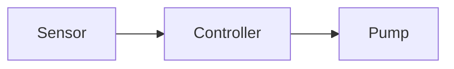

# Mermaid and three Obsidian parity items for 0.5.0

Date: 2026-11-12. Status: approved by the maintainer.

0.5.0 takes Mermaid, one of its flagship features, and three items from the 0.5.0 part of the parity list (kept in Kumbu² at `/SWE/Kumbu/Obsidian Parity/Obsidian Parity.md`): embeds in `cat`, block references and unlinked mentions. All four are well bounded and need few decisions, so they go into one overnighter. Why now: the maintainer wants 0.5.0's visible parity work done early, before the kill switch (its own spec, from 2026-11-15) takes the attention. The maintainer took the four decisions below on 2026-11-12, each the recommended option.

The work is built on one branch, one pull request, each section its own commit (or a few).

## 1. Goals, non-goals, anti-goals

Goals: §2 to §5, each testable on its own.

Non-goals:

- **Creating block ids in the web app** ("Copy link to block"). 0.5.0 reads and resolves `^id`; agents and Obsidian write them. *Maintainer, 2026-11-12: later.* Why: it needs a way to pick a block in the view, which is its own piece of work.
- **A "Link" button on unlinked mentions** that turns a mention into a link. *Maintainer, 2026-11-12: the list only.* Why: it writes into other notes (versions, shared vaults, conflicts), too much for the night.
- `aliases` as mention names, Graph, Canvas (0.6.0).
- Mermaid in the editor (Write mode shows the source as today), clickable diagram nodes (`click` callbacks), diagram export.
- Changes to the Obsidian plugin, WebDAV or sync: they carry the files as they are, and every feature here reads the same Markdown Obsidian writes.
- Checking `#Heading` subpaths in `links`: they behave as today. Only `#^id` is new.

Anti-goals, which make this a failure even if it works:

- **A diagram that breaks the page.** Malformed Mermaid shows its source and one line saying why, never an error that takes the note down, and never anything from the diagram running in the page.
- **An agent that destroys an embed by writing back what `cat` showed.** The note's own text in `cat`'s output stays byte for byte what is stored; embedded text is visibly outside it.
- **A loosened CSP.** Neither the app's nor the reader page's policy changes.
- **Mentions that leak across vaults.** Everything stays within the note's vault.

### An example from end to end

Alice keeps `/Work/Pump/Plan.md`:

````markdown
# Plan

The pump needs a new controller. ^controller



![[Ruling#Decision]]
````

and `/Work/Pump/Ruling.md` with a section `## Decision`. In `/Work/Diary/2026-11-12.md` she wrote "Talked about the plan with Bob." and in `/Work/Pump/Tasks.md` the line "- see [[Plan#^controller]]".

- In the web app, `Plan` shows the flowchart as a picture, in the dark theme's colours when the app is dark; **Show source** under it shows the code. The `^controller` marker isn't shown. The embed shows Ruling's Decision section in its frame (as today).
- In `Tasks`, tapping the link opens `Plan`, scrolls to "The pump needs a new controller." and highlights that paragraph briefly.
- Below `Plan`'s "Linked from · 1" (Tasks), a closed **Unlinked mentions** section; opened, it lists `2026-11-12` with the line "Talked about the plan with Bob.", "plan" marked; tapping it opens the diary at that line.
- An agent runs `cat /Work/Pump/Plan.md`: the note exactly as stored, then a marked block "embedded notes" with Ruling's Decision section. `cat "/Work/Pump/Plan.md#^controller"` prints "The pump needs a new controller. ^controller". `links /Work/Pump/Tasks.md` says `1: [[Plan#^controller]] → /Work/Pump/Plan.md#^controller`; had the id been `^contoller`, `→ not found: no block ^contoller in /Work/Pump/Plan.md`. `backlinks --unlinked /Work/Pump/Plan.md` gives `/Work/Diary/2026-11-12.md:1:Talked about the plan with Bob.`
- Alice publishes `Plan`: the reader page shows the flowchart as a picture too; Copy as Markdown and the AI link give the Mermaid source.

### Security boundary

Not touched: authentication, sessions, encryption and keys, accounts, sharing and roles, discreet vaults' semantics, publishing's semantics, WebDAV, sync, the CSPs (`src/Kumbu.Server/Api/Security.cs`). New reading paths read only within the vault of the note asked for, with the same permission check as `cat` and `backlinks` today (a shared vault's member reads what their role reads). Mermaid runs with `securityLevel: "strict"` and its default size limits (`maxTextSize`, `maxEdges`); its SVG reaches the page only as an image (§2.2), never as markup in the DOM; note text never reaches `dangerouslySetInnerHTML`.

## 2. Mermaid diagrams

### 2.1 Where

A fenced code block with the language `mermaid` is drawn as a diagram in every read view that renders Markdown: the note view (`web/src/note/MarkdownView.tsx`), embedded notes, checkpoint and history views that use it, and the publish reader (`web/src/reader/Reader.tsx`, which has its own renderer: give it the same component). Write mode, `cat`, Copy as Markdown, the AI link and everything an agent reads show the source as written.

### 2.2 How it is drawn: as an image

*Maintainer, 2026-11-12: as an image.* Why: Mermaid's SVG carries its own `<style>`, which the reader page's CSP (`style-src 'self'`) forbids; as an image the diagram can't touch the page at all, the CSP stays and the reader page works the same. The cost, accepted: text in a diagram can't be selected, and nodes can't be clicked.

- Mermaid is loaded only for a note that has a `mermaid` block, as KaTeX is (`web/src/note/math.ts`, `import("./math")` in MarkdownView): its own chunk, out of the first load. Follow KaTeX's way for the service worker and offline use.
- `mermaid.render` gives an SVG string; it is shown as `` (an object URL of an `image/svg+xml` Blob, revoked when the image goes or changes). `htmlLabels: false` everywhere (labels as SVG text, no `foreignObject`), and a system font stack as `fontFamily`, so measuring and drawing use the same font (an image can't load web fonts).
- Theme: Mermaid's `default` in the light theme, `dark` in the dark one (`web/src/theme/apply.ts`); a theme change redraws.
- Size: the image at its natural width, at most the text column's width (scaled down, never up); wide diagrams stay readable by opening the image in the existing lightbox if one fits, else by scrolling within its frame. The run picks one and records it.
- Accessibility: the image's `alt` is the diagram's `accTitle` and `accDescr` when the source has them, else "Diagram (<type>)", e.g. "Diagram (flowchart)". A **Show source** toggle (a button with `aria-expanded`) under each diagram shows the code block.
- Several diagrams in a note are drawn one after another, not all at once; a diagram is drawn when its block is first rendered, not before.

### 2.3 When it can't be drawn

A source Mermaid can't parse, or one past its limits: the code block as today, with one line above it: "This diagram can't be drawn: <Mermaid's first message line>". Nothing is thrown past the block. Loading Mermaid failing (offline, chunk missing): the code block, with "Diagrams can't be drawn right now."

If Mermaid's rendering does not work under the reader page's CSP (it measures text in the document while rendering), the reader page shows the code block and the run records it in `open-items.md`; the note view must work regardless.

## 3. Embeds in `cat`

*Maintainer, 2026-11-12: appended.* Why: an agent that writes back what it read must not replace an embed with a copy of the embedded text.

- `cat <path>` and `cat "<path>#section"`, standing alone (not in a pipeline, as `Cat.OutlineIfTooLong` distinguishes), print the note or section **exactly as today**, then, if it embeds notes, a blank line and a block:

  ```
  --- embedded notes: shown for reading, not part of this note's text (which ends above) ---
  [line 9: ![[Ruling#Decision]] → /Work/Pump/Ruling.md#Decision]
  ## Decision
  …
  [line 14: ![[Missing]] → not found]
  ```

- Which embeds: `![[…]]` of a note on a line of its own, as the web app shows them (`blockEmbeds`, `web/src/note/wikiLinks.ts:130`), within the range printed, outside code. With `#Heading` the section, with `#^id` the block (§4), else the whole note. One level deep: an embedded note's own embeds stay as written. Each target once, in order of first appearance; the note itself never. An embed of an attachment gets the attachment's one-line description, as `cat` gives it. Not found or ambiguous: the line with `not found` or `ambiguous: …` as `links` says it.
- In a shared vault, an embedded note last written by another user says so in the notice, as `cat` does for the note (`WriterMarks.NoticeAsync`).
- The version token stays the one of the note asked for. With `--version` there is no appendix (embeds resolve against the vault as it is now). In a pipeline there is none either: `cat x | wc -l` counts the note.
- Size: the note comes first and whole. If note and appendix pass the output limit, the appendix is cut at an embed's boundary with "[embedded notes cut here; read the rest with cat "<target>"]". A note too long on its own gets its outline as today, and the appendix lists only the embed lines, without their text.
- `cat`'s help (`src/Kumbu.Core/Sh/Commands/Cat.cs`) and the manual say so, in the style of the existing help.

## 4. Block references `^id`

### 4.1 What a block id is

As Obsidian writes them: `^` and an id of letters, digits and hyphens, at the end of a block's last line after a space, or on a line of its own right after a block it then names (for a table, a quote or a list as a whole). Blocks: a paragraph, a list item (with its nested items), a quote, a callout, a table, a heading. Not inside code. The first block with an id wins if an id repeats (the run records what Obsidian does if it finds out, else this rule).

The Markdown parsing in `src/Kumbu.Core` (sections, `SectionLookup`, `MarkdownLink`) and in the web app (`wikiLinks.ts`) is where it goes; the run decides the shape, one finder per side, tested against the same cases (a shared cases file, as `web/src/note/comments.cases.json` does for comments, is welcome).

### 4.2 Links

- `[[Note#^id]]`, `[[#^id]]`, `![[Note#^id]]` and Markdown links `[text](Note.md#^id)` (also `%5E`). The link resolver already keeps `#^block` as the subpath (`src/Kumbu.Core/Links/WikiLink.cs:15`).
- `links <note>`: `→ /Work/Pump/Plan.md#^controller` when the block exists, `→ not found: no block ^controller in /Work/Pump/Plan.md` when the note exists and the block doesn't. `links <directory>` lists such links among the broken ones.
- `cat "<path>#^id"`: the block, its marker included. Unknown id: an error in the style of an unknown section's.
- `backlinks`: unchanged (a link to a block of a note is a link to the note).
- Moving and renaming notes keeps the `#^id` of the links it rewrites (`NoteMover`); a test shows it.

### 4.3 In the web app

- Read views hide the `^id` marker (note view, embedded notes, reader page); Write mode shows it.
- A link to a block opens the note, scrolls to the block and highlights it briefly, as a jump to a line does today (`jump`, `web/src/note/NoteView.tsx:236`); with reduced motion, no animation. Unknown id: the note opens at the top with a short notice "There is no block ^<id> in this note."
- `![[Note#^id]]` on a line of its own shows the block in the embed frame (today `embedHeading` returns null for `#^`, `wikiLinks.ts:153`).

## 5. Unlinked mentions

*Maintainer, 2026-11-12: the list only.*

### 5.1 What counts

A mention of a note is its title (the file name without `.md`) in the text of another note of the same vault: ignoring case, as a whole word (no letter or digit right before or after it), outside code (fenced, indented, inline), outside links (a wikilink's or Markdown link's text and target), outside front matter. A title shorter than 3 characters has no mentions. Attachments have none. The note itself doesn't count. A note that links to this one is still listed for its other, plain mentions. The archive (`_archive/`) is left out unless asked for, as `backlinks` does. One line per source line, however many mentions it holds.

### 5.2 For agents

`backlinks --unlinked <path>`, combinable with `--archive`: the lines as `path:line:text`, in `backlinks`' order; none: "(no unlinked mentions)". `backlinks`' help says so. It reads the vault's notes as `backlinks` does (`NoteLinks.ToAsync`, `src/Kumbu.Core/Links/NoteLinks.cs`).

### 5.3 In the web app

- Below "Linked from" (`web/src/note/BacklinksList.tsx`), shown even when nothing links: a closed section **Unlinked mentions**, without a count (counting would cost a read of the whole vault for every note opened). Opening it asks the server (an addition to the backlinks endpoint, `src/Kumbu.Server/Api/NoteApi.cs:237`, or an endpoint beside it: the run decides in the API's style; `schema.d.ts` is generated, never hand-edited).
- Each entry: the note's title, the line with the mention marked (`<mark>`), its folder; tapping opens that note at that line. None: "No unlinked mentions." A failed request says so in the section, with a retry.
- The section is a disclosure button with `aria-expanded`, keyboard reachable, at least 48 px high, as the list above it.

## 6. Tests

Test-first, per section, at the level the repository tests things today: Core and server tests (xUnit) for `cat`, `links`, `backlinks --unlinked`, the block finder, moves and the API; Vitest for the web: the Mermaid component (with Mermaid mocked where a real render isn't possible in jsdom, plus one test that a parse error shows the source and the line), the hidden markers, the block jump and embed, the mentions section. The block finders of both sides run against the same cases.

## 7. Documentation

README (what the web app shows, if it lists such things), the help texts of `cat`, `links` and `backlinks` and the manual (`src/Kumbu.Core/Sh/Manual.cs`), the Welcome vault if it has a note on Markdown features, `CHANGELOG.md` under an "Unreleased" heading if the file has the pattern (else not), and `docs/concept.md` only if it lists features. Tick the four items in nothing: the parity list lives in Kumbu², the maintainer ticks it.
